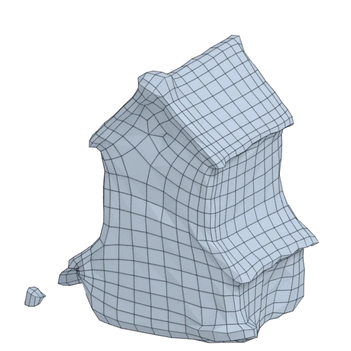

# stonemill

An extra model; 14 942 triangles in the source.
Author, source and licence: [CREDITS.md](../../CREDITS.md).

## At 3000 quads asked for

| Source | QuadriFlow (Blender) | AutoRemesher | openclare | Quad Remesher |
|---|---|---|---|---|
|  |  |  |  |  |
| 14 942 triangles | 2 635 quads | 1 809 quads | 2 974 quads | 14 140 quads |

## At equal quad count

Quad Remesher makes more quads than the 3000 it is asked for. Next to its mesh, openclare asked for as many quads as that mesh has.

| Quad Remesher | openclare, as many quads |
|---|---|
|  |  |
| 14 140 quads | 14 370 quads |

## Marks

From 0 to 100; how they are made is in [SCORES.md](../../bench/results/SCORES.md).

### 1000 quads

| Remesher | Quads | Overall | Validity | Alignment | Quad shape | Fidelity | Regularity | Structure | Budget | Speed |
|---|---|---|---|---|---|---|---|---|---|---|
| autoremesher | 703 | **11** | 0 | 24 | 40 | 0 | 0 | — | 0 | 100 |

### 3000 quads

| Remesher | Quads | Overall | Validity | Alignment | Quad shape | Fidelity | Regularity | Structure | Budget | Speed |
|---|---|---|---|---|---|---|---|---|---|---|
| openclare-uniform | 3008 | **71** | 100 | 42 | 73 | 59 | 79 | 3 | 99 | 77 |
| **openclare** | 2974 | **42** | 0 | 42 | 64 | 64 | 45 | 3 | 97 | 67 |
| quadriflow | 2635 | **36** | 40 | 39 | 53 | 16 | 22 | 1 | 51 | 79 |
| quadremesher | 14140 | **34** | 0 | 49 | 60 | 60 | 45 | — | 0 | 11 |
| quadremesher-uniform | 2859 | **29** | 0 | 41 | 57 | 15 | 0 | — | 81 | 14 |
| integer-grid | 2538 | **27** | 0 | 38 | 56 | 0 | 59 | — | 38 | 45 |
| instant-meshes | 2664 | **27** | 20 | 36 | 52 | 0 | 7 | 3 | 55 | 100 |
| autoremesher | 1809 | **19** | 0 | 34 | 44 | 0 | 45 | — | 0 | 99 |

At equal quad count: Quad Remesher's mesh as it is, and openclare asked for as many quads.

| Remesher | Quads | Overall | Validity | Alignment | Quad shape | Fidelity | Regularity | Structure | Budget | Speed |
|---|---|---|---|---|---|---|---|---|---|---|
| openclare-matched | 14370 | **71** | 100 | 46 | 75 | 70 | 77 | 5 | 93 | 35 |
| quadremesher-as-made | 14140 | **31** | 0 | 43 | 60 | 29 | 45 | — | 100 | 11 |

### 8000 quads

| Remesher | Quads | Overall | Validity | Alignment | Quad shape | Fidelity | Regularity | Structure | Budget | Speed |
|---|---|---|---|---|---|---|---|---|---|---|
| autoremesher | 4327 | **23** | 0 | 39 | 46 | 0 | 72 | — | 0 | 76 |
