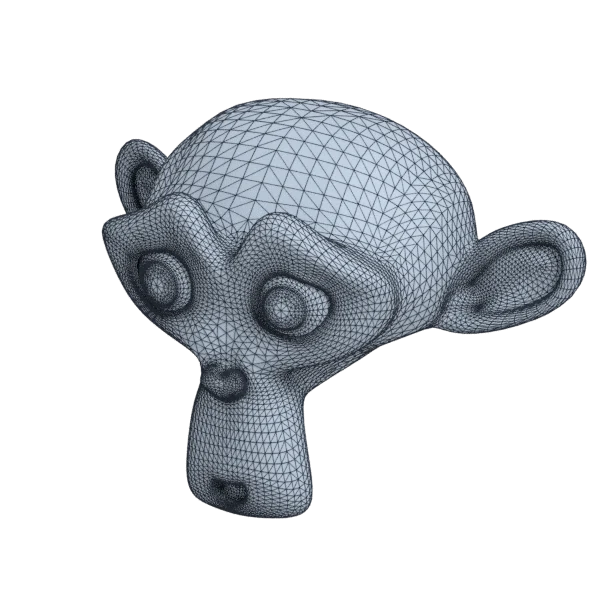
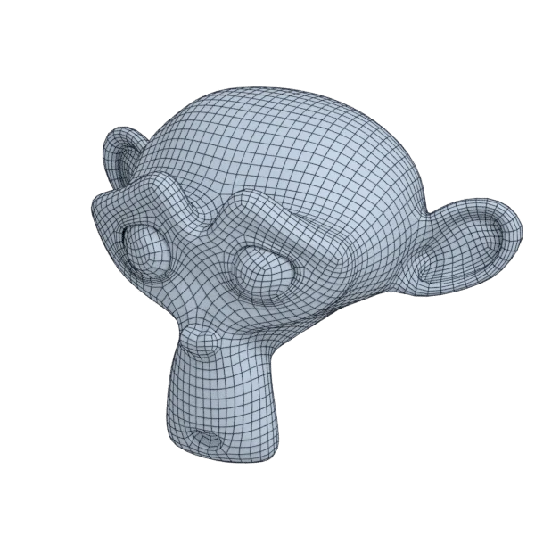

# suzanne

An organic model, with open borders; 15 744 triangles in the source.
Author, source and licence: [CREDITS.md](../../CREDITS.md).

## At 3000 quads asked for

| Source | QuadriFlow (Blender) | openclare | Quad Remesher |
|---|---|---|---|
|  |  |  |  |
| 15 744 triangles | 3 012 quads | 2 986 quads | 4 310 quads |

## At equal quad count

Quad Remesher makes more quads than the 3000 it is asked for. Next to its mesh, openclare asked for as many quads as that mesh has.

| Quad Remesher | openclare, as many quads |
|---|---|
|  |  |
| 4 310 quads | 4 306 quads |

## Marks

From 0 to 100; how they are made is in [SCORES.md](../../bench/results/SCORES.md).

### 1000 quads

| Remesher | Quads | Overall | Validity | Alignment | Quad shape | Fidelity | Regularity | Structure | Budget | Speed |
|---|---|---|---|---|---|---|---|---|---|---|
| **openclare** | 994 | **76** | 100 | 54 | 72 | 82 | 52 | 44 | 98 | 86 |
| openclare-uniform | 1002 | **75** | 100 | 49 | 76 | 73 | 56 | 40 | 99 | 99 |
| quadremesher-uniform | 922 | **66** | 100 | 57 | 57 | 70 | 26 | 13 | 69 | 68 |
| quadremesher | 1790 | **65** | 100 | 62 | 56 | 84 | 62 | 14 | 0 | 63 |
| integer-grid | 976 | **41** | 0 | 48 | 55 | 51 | 48 | 25 | 90 | 56 |
| quadriflow | 1005 | **33** | 0 | 30 | 52 | 45 | 33 | 1 | 96 | 100 |
| instant-meshes | 958 | **24** | 0 | 21 | 49 | 26 | 0 | 3 | 83 | 100 |

At equal quad count: Quad Remesher's mesh as it is, and openclare asked for as many quads.

| Remesher | Quads | Overall | Validity | Alignment | Quad shape | Fidelity | Regularity | Structure | Budget | Speed |
|---|---|---|---|---|---|---|---|---|---|---|
| openclare-matched | 1771 | **78** | 100 | 53 | 76 | 87 | 72 | 52 | 96 | 92 |
| quadremesher-as-made | 1790 | **72** | 100 | 60 | 56 | 83 | 62 | 14 | 100 | 63 |

### 3000 quads

| Remesher | Quads | Overall | Validity | Alignment | Quad shape | Fidelity | Regularity | Structure | Budget | Speed |
|---|---|---|---|---|---|---|---|---|---|---|
| **openclare** | 2986 | **80** | 100 | 56 | 78 | 85 | 81 | 33 | 98 | 80 |
| openclare-uniform | 2980 | **79** | 100 | 54 | 78 | 82 | 82 | 17 | 97 | 88 |
| integer-grid | 2757 | **73** | 100 | 54 | 64 | 75 | 81 | 33 | 68 | 48 |
| quadremesher-uniform | 2628 | **70** | 100 | 54 | 61 | 73 | 73 | 30 | 50 | 72 |
| instant-meshes | 3070 | **46** | 40 | 24 | 65 | 58 | 31 | 2 | 91 | 100 |
| quadremesher | 4310 | **45** | 0 | 61 | 61 | 88 | 81 | 42 | 0 | 70 |
| quadriflow | 3030 | **39** | 0 | 32 | 57 | 41 | 82 | 5 | 96 | 71 |

At equal quad count: Quad Remesher's mesh as it is, and openclare asked for as many quads.

| Remesher | Quads | Overall | Validity | Alignment | Quad shape | Fidelity | Regularity | Structure | Budget | Speed |
|---|---|---|---|---|---|---|---|---|---|---|
| openclare-matched | 4306 | **81** | 100 | 56 | 78 | 89 | 87 | 56 | 100 | 69 |
| quadremesher-as-made | 4310 | **49** | 0 | 60 | 61 | 86 | 81 | 42 | 100 | 70 |

### 8000 quads

| Remesher | Quads | Overall | Validity | Alignment | Quad shape | Fidelity | Regularity | Structure | Budget | Speed |
|---|---|---|---|---|---|---|---|---|---|---|
| openclare-uniform | 8040 | **83** | 100 | 56 | 73 | 91 | 92 | 56 | 98 | 63 |
| **openclare** | 8103 | **81** | 100 | 56 | 70 | 94 | 90 | 41 | 95 | 50 |
| quadremesher-uniform | 7317 | **78** | 100 | 56 | 65 | 90 | 90 | 54 | 66 | 61 |
| integer-grid | 7376 | **77** | 100 | 56 | 62 | 90 | 91 | 42 | 69 | 0 |
| quadremesher | 9246 | **77** | 100 | 62 | 65 | 93 | 92 | 56 | 38 | 50 |
| quadriflow | 7983 | **76** | 100 | 37 | 70 | 86 | 93 | 22 | 97 | 53 |
| instant-meshes | 8098 | **70** | 100 | 26 | 74 | 88 | 57 | 3 | 95 | 100 |

At equal quad count: Quad Remesher's mesh as it is, and openclare asked for as many quads.

| Remesher | Quads | Overall | Validity | Alignment | Quad shape | Fidelity | Regularity | Structure | Budget | Speed |
|---|---|---|---|---|---|---|---|---|---|---|
| quadremesher-as-made | 9246 | **81** | 100 | 62 | 65 | 93 | 92 | 56 | 100 | 50 |
| openclare-matched | 9380 | **80** | 100 | 58 | 70 | 95 | 91 | 36 | 94 | 52 |
