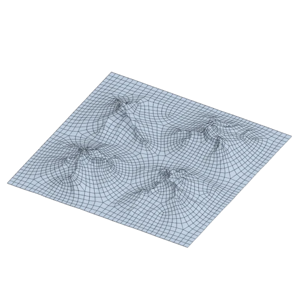

# terrain

An extra model, with open borders; 543 557 triangles in the source.
Its licence does not allow passing it on: the model is not in the repository (`make blenderkit`).
Author, source and licence: [CREDITS.md](../../CREDITS.md).

## At 3000 quads

| Source | QuadriFlow (Blender) | openclare | Quad Remesher |
|---|---|---|---|
|  |  |  |  |

## Marks

From 0 to 100; how they are made is in [SCORES.md](../../bench/results/SCORES.md).

### 1000 quads

| Remesher | Overall | Validity | Alignment | Quad shape | Fidelity | Regularity | Structure | Budget | Speed |
|---|---|---|---|---|---|---|---|---|---|
| quad-layout | **65** | 100 | 20 | 72 | 51 | 65 | 36 | 93 | 52 |
| **quad-layout-adaptive** | **64** | 100 | 23 | 70 | 45 | 62 | 36 | 97 | 52 |

### 3000 quads

| Remesher | Overall | Validity | Alignment | Quad shape | Fidelity | Regularity | Structure | Budget | Speed |
|---|---|---|---|---|---|---|---|---|---|
| quad-layout | **67** | 100 | 17 | 69 | 57 | 81 | 43 | 96 | 50 |
| **quad-layout-adaptive** | **65** | 100 | 17 | 67 | 62 | 67 | 23 | 95 | 47 |
| quadriflow | **61** | 100 | 10 | 68 | 52 | 59 | 70 | 62 | 23 |
| integer-grid | **57** | 100 | 17 | 53 | 46 | 78 | 60 | 34 | 34 |
| quadremesher-uniform | **55** | 100 | 17 | 59 | 50 | 36 | 36 | 46 | 27 |
| instant-meshes | **40** | 100 | 6 | 59 | 0 | 34 | 31 | 0 | 47 |
| quadremesher | **29** | 0 | 19 | 52 | 75 | 51 | — | 0 | 25 |

### 8000 quads

| Remesher | Overall | Validity | Alignment | Quad shape | Fidelity | Regularity | Structure | Budget | Speed |
|---|---|---|---|---|---|---|---|---|---|
| quad-layout | **71** | 100 | 21 | 67 | 76 | 85 | 33 | 98 | 42 |
| **quad-layout-adaptive** | **69** | 100 | 22 | 65 | 82 | 72 | 15 | 95 | 36 |
| quadriflow | **63** | 100 | 7 | 71 | 66 | 73 | 70 | 48 | 25 |
| quadremesher-uniform | **62** | 100 | 18 | 60 | 66 | 65 | 39 | 59 | 22 |
| integer-grid | **61** | 100 | 21 | 52 | 64 | 82 | 35 | 44 | 13 |
| instant-meshes | **36** | 80 | 5 | 63 | 0 | 43 | 25 | 0 | 46 |
| quadremesher | **33** | 0 | 20 | 57 | 79 | 75 | 30 | 0 | 21 |
