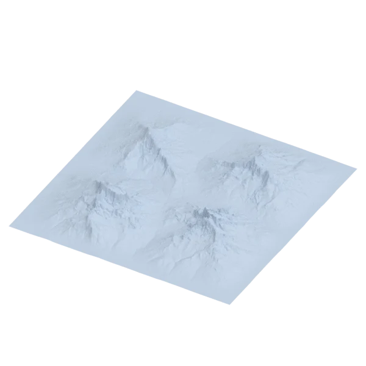
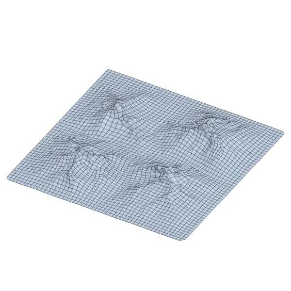
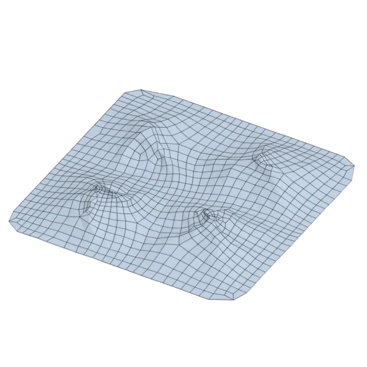
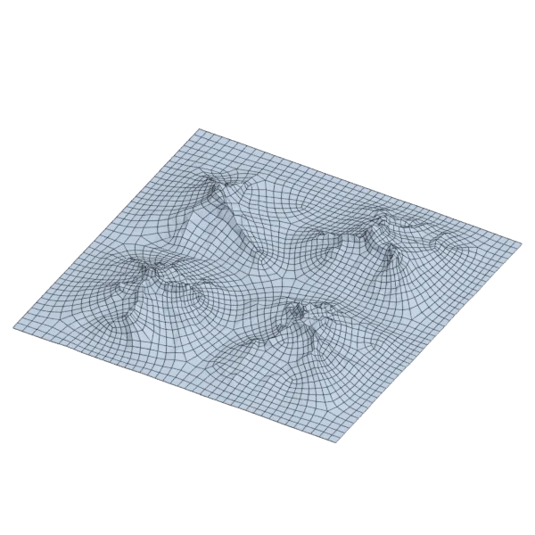

# terrain

An extra model, with open borders; 543 557 triangles in the source.
Its licence does not allow passing it on: the model is not in the repository (`make blenderkit`).
Author, source and licence: [CREDITS.md](../../CREDITS.md).

## At 3000 quads asked for

| Source | QuadriFlow (Blender) | AutoRemesher | openclare |
|---|---|---|---|
|  |  |  |  |
| 543 557 triangles | 2 775 quads | 919 quads | 3 032 quads |

## Edge loops

At 3000 quads asked for. Each loop is followed straight on through every regular vertex: it closes, comes back beside itself a quad further (a spiral), stops at an irregular vertex, or runs from a border to a border. Share of the edges on each, those of borders and of faces that are not quads left out; "—" where the mesh is not a manifold.

| | closed | spiral | stops | border to border | spirals | longest that stops |
|---|---|---|---|---|---|---|
| Modelled by hand | — | — | — | — | — | — |
| QuadriFlow (Blender) | 0 % | 0 % | 53 % | 47 % | 0 | 46 |
| AutoRemesher | 0 % | 0 % | 68 % | 32 % | 0 | 27 |
| openclare | 0 % | 2 % | 83 % | 15 % | 1 | 110 |

## Marks

From 0 to 100; how they are made is in [SCORES.md](../../bench/results/SCORES.md).

### 1000 quads

| Remesher | Quads | Overall | Validity | Alignment | Quad shape | Fidelity | Regularity | Structure | Edge loops | Budget | Speed |
|---|---|---|---|---|---|---|---|---|---|---|---|
| openclare-uniform | 1004 | **73** | 100 | 31 | 100 | 50 | 100 | 54 | 50 | 98 | 50 |
| **openclare** | 1011 | **71** | 100 | 27 | 100 | 51 | 100 | 41 | 49 | 96 | 48 |
| integer-grid | 896 | **70** | 100 | 32 | 88 | 41 | 100 | 64 | — | 58 | 47 |
| quadriflow | 872 | **66** | 100 | 23 | 100 | 40 | 100 | 65 | 50 | 49 | 27 |
| instant-meshes | 574 | **55** | 100 | 24 | 96 | 5 | 80 | 31 | — | 0 | 47 |
| autoremesher | 308 | **10** | 0 | 1 | 0 | 0 | 53 | — | 34 | 0 | 87 |

### 3000 quads

| Remesher | Quads | Overall | Validity | Alignment | Quad shape | Fidelity | Regularity | Structure | Edge loops | Budget | Speed |
|---|---|---|---|---|---|---|---|---|---|---|---|
| **openclare** | 3032 | **73** | 100 | 28 | 100 | 66 | 100 | 26 | 50 | 96 | 46 |
| openclare-uniform | 3029 | **73** | 100 | 30 | 100 | 54 | 100 | 51 | 50 | 96 | 44 |
| quadriflow | 2717 | **67** | 100 | 16 | 100 | 43 | 100 | 70 | 50 | 62 | 27 |
| integer-grid | 2502 | **66** | 100 | 26 | 92 | 40 | 100 | 60 | — | 34 | 35 |
| autoremesher | 919 | **54** | 85 | 15 | 100 | 15 | 100 | — | 50 | 0 | 84 |
| instant-meshes | 1753 | **54** | 100 | 9 | 99 | 13 | 84 | 31 | — | 0 | 47 |

### 8000 quads

| Remesher | Quads | Overall | Validity | Alignment | Quad shape | Fidelity | Regularity | Structure | Edge loops | Budget | Speed |
|---|---|---|---|---|---|---|---|---|---|---|---|
| **openclare** | 8099 | **74** | 100 | 35 | 100 | 74 | 100 | 11 | 51 | 95 | 36 |
| openclare-uniform | 7903 | **74** | 100 | 33 | 100 | 66 | 100 | 31 | 51 | 95 | 40 |
| integer-grid | 6773 | **67** | 100 | 33 | 87 | 46 | 100 | 37 | — | 39 | 7 |
| quadriflow | 6963 | **65** | 100 | 10 | 100 | 49 | 100 | 70 | 50 | 48 | 28 |
| autoremesher | 2975 | **55** | 88 | 11 | 100 | 26 | 100 | — | 50 | 0 | 65 |
| instant-meshes | 4807 | **48** | 80 | 7 | 100 | 8 | 93 | 25 | — | 0 | 44 |
