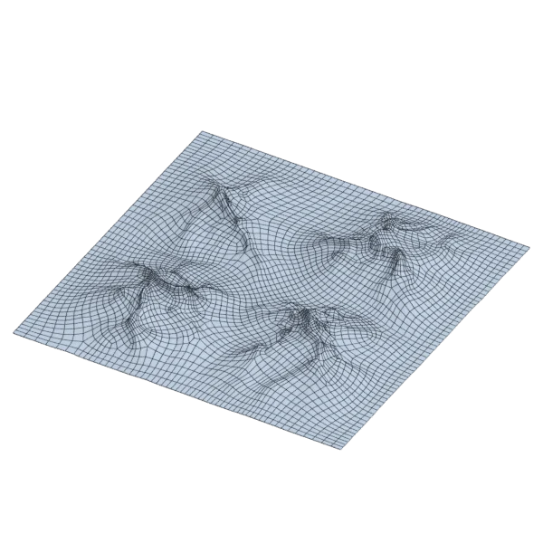

# terrain

An extra model, with open borders; 543 557 triangles in the source.
Its licence does not allow passing it on: the model is not in the repository (`make blenderkit`).
Author, source and licence: [CREDITS.md](../../CREDITS.md).

## At 3000 quads asked for

| Source | QuadriFlow (Blender) | openclare | Quad Remesher |
|---|---|---|---|
|  |  |  |  |
| 543 557 triangles | 2 775 quads | 2 965 quads | 4 677 quads |

## At equal quad count

Quad Remesher makes more quads than the 3000 it is asked for. Next to its mesh, openclare asked for as many quads as that mesh has.

| Quad Remesher | openclare, as many quads |
|---|---|
|  |  |
| 4 677 quads | 4 638 quads |

## Marks

From 0 to 100; how they are made is in [SCORES.md](../../bench/results/SCORES.md).

### 1000 quads

| Remesher | Quads | Overall | Validity | Alignment | Quad shape | Fidelity | Regularity | Structure | Budget | Speed |
|---|---|---|---|---|---|---|---|---|---|---|
| openclare-uniform | 1017 | **66** | 100 | 21 | 72 | 54 | 65 | 36 | 93 | 53 |
| **openclare** | 993 | **66** | 100 | 22 | 70 | 54 | 62 | 36 | 97 | 51 |
| integer-grid | 885 | **58** | 100 | 21 | 50 | 42 | 63 | 70 | 54 | 41 |
| quadriflow | 872 | **57** | 100 | 14 | 66 | 40 | 50 | 65 | 49 | 27 |
| quadremesher | 1541 | **46** | 100 | 16 | 44 | 70 | 1 | 6 | 0 | 27 |
| instant-meshes | 574 | **42** | 100 | 16 | 57 | 5 | 30 | 31 | 0 | 47 |
| quadremesher-uniform | 878 | **22** | 0 | 11 | 46 | 42 | 0 | — | 51 | 25 |

At equal quad count: Quad Remesher's mesh as it is, and openclare asked for as many quads.

| Remesher | Quads | Overall | Validity | Alignment | Quad shape | Fidelity | Regularity | Structure | Budget | Speed |
|---|---|---|---|---|---|---|---|---|---|---|
| openclare-matched | 1569 | **62** | 100 | 17 | 71 | 50 | 73 | 36 | 93 | 42 |
| quadremesher-as-made | 1541 | **50** | 100 | 16 | 44 | 67 | 1 | 6 | 100 | 27 |

### 3000 quads

| Remesher | Quads | Overall | Validity | Alignment | Quad shape | Fidelity | Regularity | Structure | Budget | Speed |
|---|---|---|---|---|---|---|---|---|---|---|
| openclare-uniform | 2968 | **67** | 100 | 17 | 69 | 54 | 81 | 43 | 96 | 44 |
| **openclare** | 2965 | **65** | 100 | 17 | 66 | 61 | 67 | 23 | 95 | 45 |
| quadriflow | 2717 | **59** | 100 | 10 | 68 | 43 | 59 | 70 | 62 | 23 |
| integer-grid | 2502 | **56** | 100 | 17 | 53 | 40 | 78 | 60 | 34 | 38 |
| quadremesher-uniform | 2597 | **54** | 100 | 17 | 59 | 43 | 36 | 36 | 46 | 27 |
| instant-meshes | 1753 | **42** | 100 | 6 | 59 | 13 | 34 | 31 | 0 | 47 |
| quadremesher | 4677 | **29** | 0 | 19 | 52 | 73 | 51 | — | 0 | 25 |

At equal quad count: Quad Remesher's mesh as it is, and openclare asked for as many quads.

| Remesher | Quads | Overall | Validity | Alignment | Quad shape | Fidelity | Regularity | Structure | Budget | Speed |
|---|---|---|---|---|---|---|---|---|---|---|
| openclare-matched | 4638 | **63** | 100 | 20 | 65 | 70 | 69 | 15 | 97 | 40 |
| quadremesher-as-made | 4677 | **31** | 0 | 18 | 52 | 69 | 51 | — | 100 | 25 |

### 8000 quads

| Remesher | Quads | Overall | Validity | Alignment | Quad shape | Fidelity | Regularity | Structure | Budget | Speed |
|---|---|---|---|---|---|---|---|---|---|---|
| openclare-uniform | 8042 | **69** | 100 | 21 | 66 | 65 | 85 | 33 | 98 | 42 |
| **openclare** | 7905 | **67** | 100 | 22 | 64 | 73 | 72 | 15 | 95 | 37 |
| quadriflow | 6963 | **60** | 100 | 7 | 71 | 49 | 73 | 70 | 48 | 23 |
| quadremesher-uniform | 7183 | **59** | 100 | 18 | 60 | 48 | 65 | 39 | 59 | 22 |
| integer-grid | 6874 | **58** | 100 | 20 | 52 | 45 | 82 | 35 | 44 | 12 |
| instant-meshes | 4807 | **37** | 80 | 5 | 63 | 8 | 43 | 25 | 0 | 44 |
| quadremesher | 11819 | **32** | 0 | 20 | 57 | 68 | 75 | 30 | 0 | 21 |

At equal quad count: Quad Remesher's mesh as it is, and openclare asked for as many quads.

| Remesher | Quads | Overall | Validity | Alignment | Quad shape | Fidelity | Regularity | Structure | Budget | Speed |
|---|---|---|---|---|---|---|---|---|---|---|
| openclare-matched | 11801 | **65** | 100 | 23 | 68 | 73 | 73 | 11 | 99 | 34 |
| quadremesher-as-made | 11819 | **34** | 0 | 19 | 57 | 62 | 75 | 30 | 100 | 21 |
