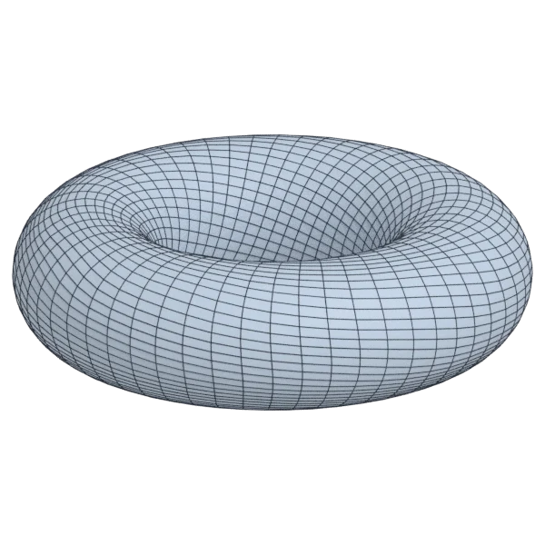
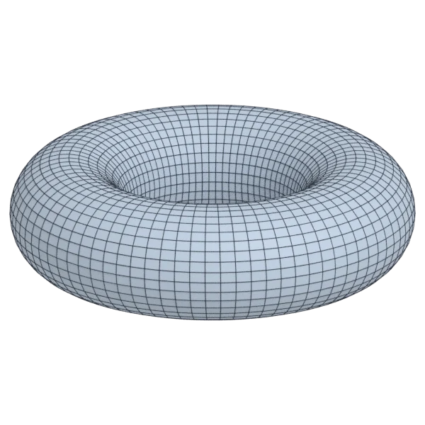
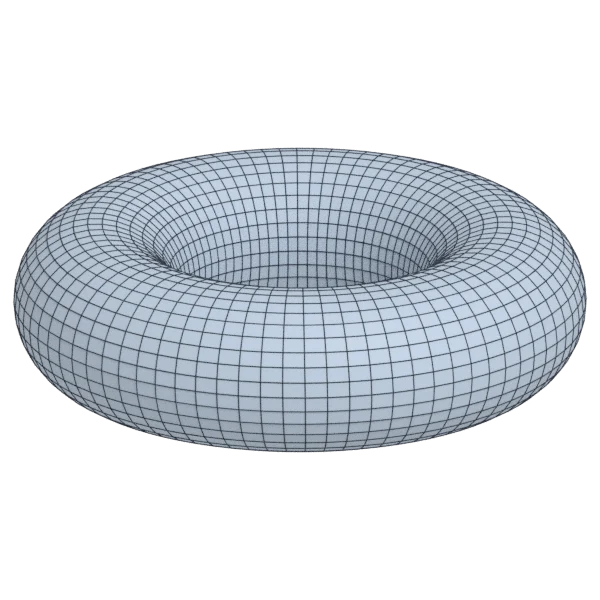

# torus

A calibration model; 9 216 triangles in the source.
Author, source and licence: [CREDITS.md](../../CREDITS.md).

## At 3000 quads asked for

| Source | QuadriFlow (Blender) | AutoRemesher | openclare | Quad Remesher |
|---|---|---|---|---|
|  |  |  |  |  |
| 9 216 triangles | 2 855 quads | 2 672 quads | 2 952 quads | 2 824 quads |

## At equal quad count

Quad Remesher makes more quads than the 3000 it is asked for. Next to its mesh, openclare asked for as many quads as that mesh has.

| Quad Remesher | openclare, as many quads |
|---|---|
|  |  |
| 2 824 quads | 2 800 quads |

## Edge loops

At 3000 quads asked for. Each loop is followed straight on through every regular vertex: it closes, comes back beside itself a quad further (a spiral), stops at an irregular vertex, or runs from a border to a border. Share of the edges on each, those of borders and of faces that are not quads left out; "—" where the mesh is not a manifold.

| | closed | spiral | stops | border to border | spirals | longest that stops |
|---|---|---|---|---|---|---|
| QuadriFlow (Blender) | 0 % | 44 % | 56 % | 0 % | 7 | 411 |
| AutoRemesher | 0 % | 100 % | 0 % | 0 % | 6 | 0 |
| openclare | 100 % | 0 % | 0 % | 0 % | 0 | 0 |
| Quad Remesher | 10 % | 81 % | 9 % | 0 % | 10 | 108 |

## Marks

From 0 to 100; how they are made is in [SCORES.md](../../bench/results/SCORES.md).

### 1000 quads

| Remesher | Quads | Overall | Validity | Alignment | Quad shape | Fidelity | Regularity | Structure | Edge loops | Budget | Speed |
|---|---|---|---|---|---|---|---|---|---|---|---|
| **openclare** | 1008 | **98** | 100 | 99 | 88 | 97 | 100 | 100 | 100 | 97 | 100 |
| openclare-uniform | 1008 | **97** | 100 | 99 | 88 | 97 | 100 | 100 | — | 97 | 96 |
| quadremesher | 920 | **94** | 100 | 97 | 88 | 95 | 100 | 100 | 100 | 68 | 64 |
| integer-grid | 920 | **94** | 100 | 97 | 87 | 97 | 100 | 100 | — | 68 | 100 |
| quadremesher-uniform | 920 | **94** | 100 | 97 | 88 | 95 | 100 | 100 | — | 68 | 77 |
| autoremesher | 728 | **85** | 100 | 91 | 77 | 89 | 100 | 100 | 100 | 0 | 100 |
| instant-meshes | 1054 | **70** | 100 | 61 | 57 | 92 | 15 | 12 | — | 78 | 100 |
| quadriflow | 1028 | **66** | 100 | 39 | 61 | 94 | 81 | 1 | 0 | 89 | 100 |

At equal quad count: Quad Remesher's mesh as it is, and openclare asked for as many quads.

| Remesher | Quads | Overall | Validity | Alignment | Quad shape | Fidelity | Regularity | Structure | Edge loops | Budget | Speed |
|---|---|---|---|---|---|---|---|---|---|---|---|
| openclare-matched | 920 | **97** | 100 | 97 | 87 | 97 | 100 | 100 | — | 100 | 100 |
| quadremesher-as-made | 920 | **96** | 100 | 97 | 88 | 95 | 100 | 100 | — | 100 | 64 |

### 3000 quads

| Remesher | Quads | Overall | Validity | Alignment | Quad shape | Fidelity | Regularity | Structure | Edge loops | Budget | Speed |
|---|---|---|---|---|---|---|---|---|---|---|---|
| **openclare** | 2952 | **98** | 100 | 97 | 93 | 99 | 100 | 100 | 100 | 94 | 75 |
| openclare-uniform | 2952 | **98** | 100 | 97 | 93 | 99 | 100 | 100 | — | 94 | 79 |
| integer-grid | 2720 | **94** | 100 | 97 | 93 | 99 | 100 | 100 | — | 63 | 83 |
| quadremesher-uniform | 2824 | **83** | 100 | 69 | 74 | 97 | 96 | 20 | — | 77 | 74 |
| quadremesher | 2824 | **79** | 100 | 69 | 74 | 97 | 96 | 20 | 44 | 77 | 62 |
| autoremesher | 2672 | **75** | 100 | 54 | 79 | 97 | 100 | 100 | 0 | 56 | 100 |
| instant-meshes | 3078 | **73** | 100 | 37 | 72 | 97 | 59 | 0 | — | 90 | 100 |
| quadriflow | 2976 | **51** | 20 | 55 | 49 | 96 | 90 | 0 | 0 | 97 | 89 |

At equal quad count: Quad Remesher's mesh as it is, and openclare asked for as many quads.

| Remesher | Quads | Overall | Validity | Alignment | Quad shape | Fidelity | Regularity | Structure | Edge loops | Budget | Speed |
|---|---|---|---|---|---|---|---|---|---|---|---|
| openclare-matched | 2800 | **98** | 100 | 97 | 93 | 99 | 100 | 100 | — | 97 | 84 |
| quadremesher-as-made | 2824 | **83** | 100 | 69 | 74 | 97 | 96 | 20 | — | 100 | 62 |

### 8000 quads

| Remesher | Quads | Overall | Validity | Alignment | Quad shape | Fidelity | Regularity | Structure | Edge loops | Budget | Speed |
|---|---|---|---|---|---|---|---|---|---|---|---|
| **openclare** | 8024 | **99** | 100 | 97 | 95 | 99 | 100 | 100 | 100 | 99 | 60 |
| openclare-uniform | 8024 | **99** | 100 | 97 | 95 | 99 | 100 | 100 | — | 99 | 65 |
| autoremesher | 7544 | **96** | 100 | 97 | 94 | 98 | 100 | 100 | 100 | 77 | 81 |
| integer-grid | 7280 | **95** | 100 | 97 | 95 | 99 | 100 | 100 | — | 64 | 54 |
| quadremesher-uniform | 7401 | **86** | 100 | 81 | 82 | 99 | 97 | 19 | — | 70 | 57 |
| instant-meshes | 8038 | **82** | 100 | 72 | 74 | 99 | 67 | 1 | — | 98 | 100 |
| quadremesher | 7401 | **80** | 100 | 81 | 82 | 99 | 97 | 19 | 26 | 70 | 55 |
| quadriflow | 9147 | **53** | 40 | 49 | 63 | 99 | 98 | 1 | 0 | 43 | 59 |

At equal quad count: Quad Remesher's mesh as it is, and openclare asked for as many quads.

| Remesher | Quads | Overall | Validity | Alignment | Quad shape | Fidelity | Regularity | Structure | Edge loops | Budget | Speed |
|---|---|---|---|---|---|---|---|---|---|---|---|
| openclare-matched | 7467 | **99** | 100 | 97 | 95 | 99 | 100 | 100 | — | 96 | 64 |
| quadremesher-as-made | 7401 | **88** | 100 | 81 | 82 | 99 | 97 | 19 | — | 100 | 55 |
