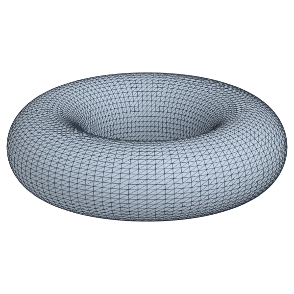
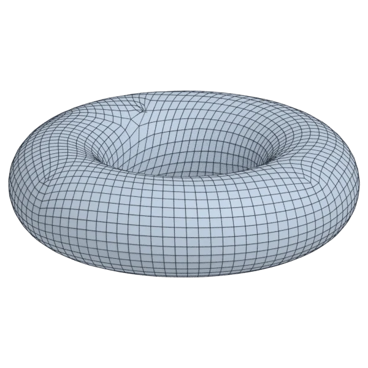
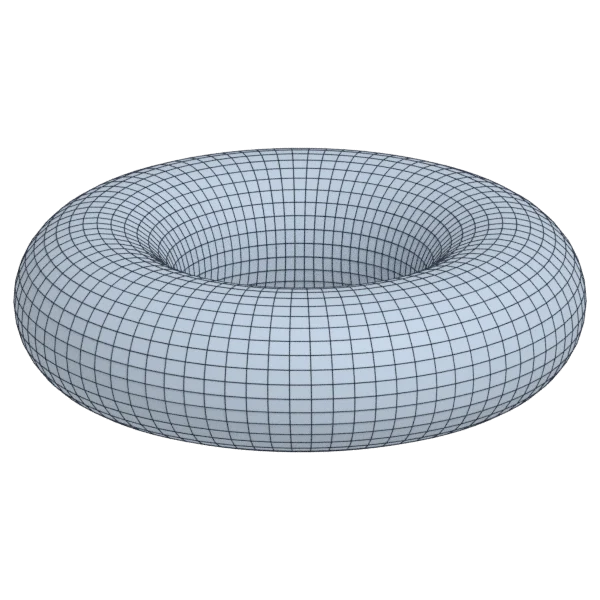
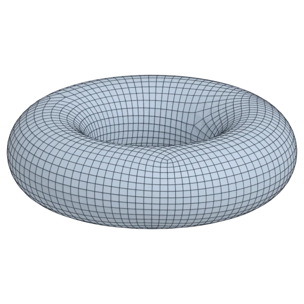

# torus

A calibration model; 9 216 triangles in the source.
Author, source and licence: [CREDITS.md](../../CREDITS.md).

## At 3000 quads

| Source | QuadriFlow (Blender) | openclare | Quad Remesher |
|---|---|---|---|
|  |  |  |  |

## Marks

From 0 to 100; how they are made is in [SCORES.md](../../bench/results/SCORES.md).

### 1000 quads

| Remesher | Quads | Overall | Validity | Alignment | Quad shape | Fidelity | Regularity | Structure | Budget | Speed |
|---|---|---|---|---|---|---|---|---|---|---|
| **quad-layout-adaptive** | 1008 | **97** | 100 | 99 | 88 | 97 | 100 | 100 | 97 | 99 |
| quad-layout | 1008 | **97** | 100 | 99 | 88 | 97 | 100 | 100 | 97 | 100 |
| integer-grid | 920 | **94** | 100 | 97 | 87 | 97 | 100 | 100 | 68 | 100 |
| quadremesher | 920 | **94** | 100 | 97 | 88 | 95 | 100 | 100 | 68 | 64 |
| quadremesher-uniform | 920 | **94** | 100 | 97 | 88 | 95 | 100 | 100 | 68 | 77 |
| quadriflow | 1028 | **73** | 100 | 39 | 61 | 94 | 81 | 1 | 89 | 100 |
| instant-meshes | 1054 | **70** | 100 | 61 | 57 | 92 | 15 | 12 | 78 | 100 |

At equal quad count: Quad Remesher's mesh as it is, and openclare asked for as many quads.

| Remesher | Quads | Overall | Validity | Alignment | Quad shape | Fidelity | Regularity | Structure | Budget | Speed |
|---|---|---|---|---|---|---|---|---|---|---|
| quad-layout-matched | 920 | **97** | 100 | 97 | 87 | 97 | 100 | 100 | 100 | 92 |
| quadremesher-as-made | 920 | **96** | 100 | 97 | 88 | 95 | 100 | 100 | 100 | 64 |

### 3000 quads

| Remesher | Quads | Overall | Validity | Alignment | Quad shape | Fidelity | Regularity | Structure | Budget | Speed |
|---|---|---|---|---|---|---|---|---|---|---|
| **quad-layout-adaptive** | 2952 | **98** | 100 | 97 | 93 | 99 | 100 | 100 | 94 | 86 |
| quad-layout | 2952 | **98** | 100 | 97 | 93 | 99 | 100 | 100 | 94 | 88 |
| integer-grid | 2720 | **94** | 100 | 97 | 93 | 99 | 100 | 100 | 63 | 83 |
| quadremesher | 2824 | **83** | 100 | 69 | 74 | 97 | 96 | 20 | 77 | 62 |
| quadremesher-uniform | 2824 | **83** | 100 | 69 | 74 | 97 | 96 | 20 | 77 | 74 |
| instant-meshes | 3078 | **73** | 100 | 37 | 72 | 97 | 59 | 0 | 90 | 100 |
| quadriflow | 2976 | **56** | 20 | 55 | 49 | 96 | 90 | 0 | 97 | 89 |

At equal quad count: Quad Remesher's mesh as it is, and openclare asked for as many quads.

| Remesher | Quads | Overall | Validity | Alignment | Quad shape | Fidelity | Regularity | Structure | Budget | Speed |
|---|---|---|---|---|---|---|---|---|---|---|
| quad-layout-matched | 2800 | **98** | 100 | 97 | 93 | 99 | 100 | 100 | 97 | 79 |
| quadremesher-as-made | 2824 | **83** | 100 | 69 | 74 | 97 | 96 | 20 | 100 | 62 |

### 8000 quads

| Remesher | Quads | Overall | Validity | Alignment | Quad shape | Fidelity | Regularity | Structure | Budget | Speed |
|---|---|---|---|---|---|---|---|---|---|---|
| **quad-layout-adaptive** | 8024 | **99** | 100 | 97 | 95 | 99 | 100 | 100 | 99 | 61 |
| quad-layout | 8024 | **99** | 100 | 97 | 95 | 99 | 100 | 100 | 99 | 64 |
| integer-grid | 7280 | **95** | 100 | 97 | 95 | 99 | 100 | 100 | 64 | 57 |
| quadremesher | 7401 | **86** | 100 | 81 | 82 | 99 | 97 | 19 | 70 | 55 |
| quadremesher-uniform | 7401 | **86** | 100 | 81 | 82 | 99 | 97 | 19 | 70 | 57 |
| instant-meshes | 8038 | **82** | 100 | 72 | 74 | 99 | 67 | 1 | 98 | 100 |
| quadriflow | 9147 | **58** | 40 | 49 | 63 | 99 | 98 | 1 | 43 | 49 |

At equal quad count: Quad Remesher's mesh as it is, and openclare asked for as many quads.

| Remesher | Quads | Overall | Validity | Alignment | Quad shape | Fidelity | Regularity | Structure | Budget | Speed |
|---|---|---|---|---|---|---|---|---|---|---|
| quad-layout-matched | 7467 | **99** | 100 | 97 | 95 | 99 | 100 | 100 | 96 | 59 |
| quadremesher-as-made | 7401 | **88** | 100 | 81 | 82 | 99 | 97 | 19 | 100 | 55 |
