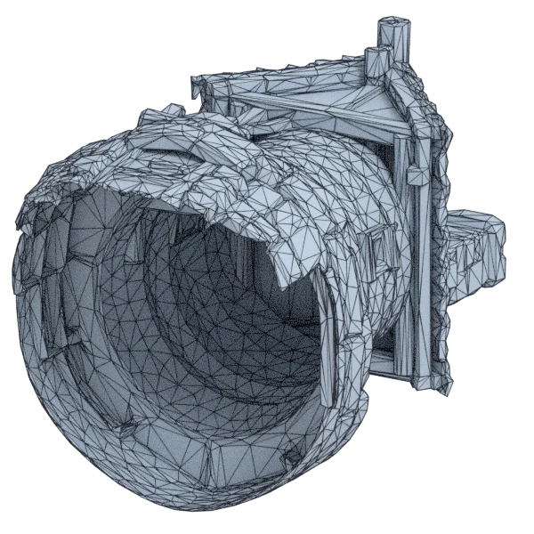
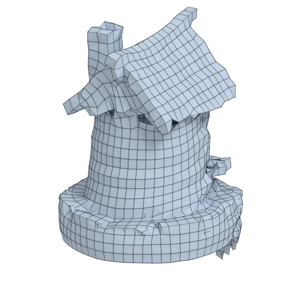
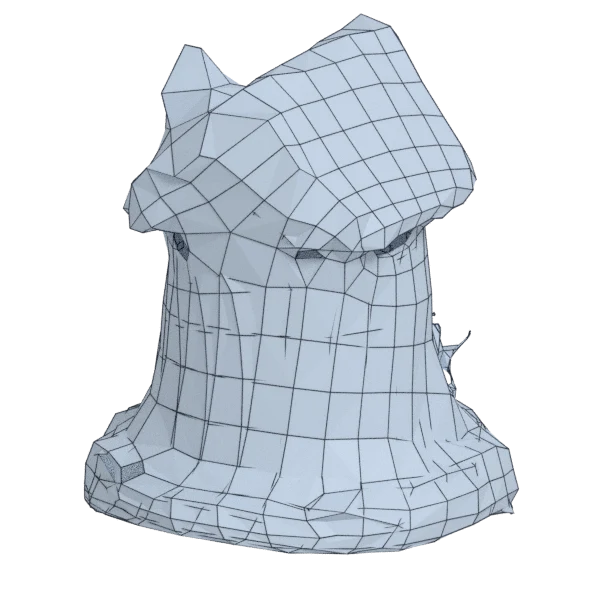
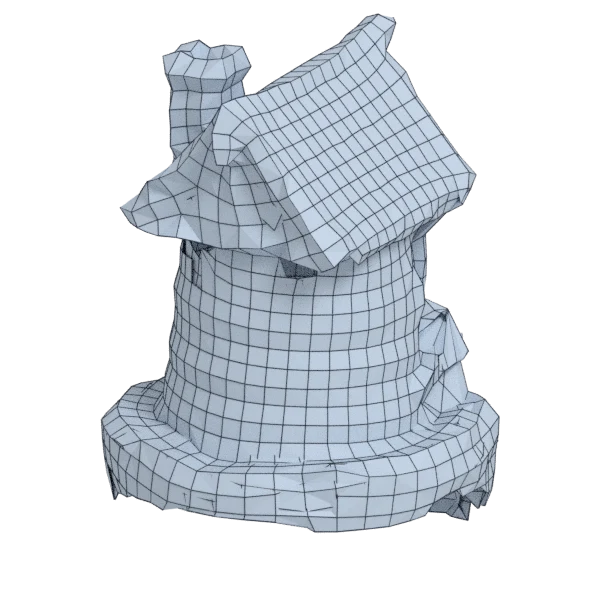
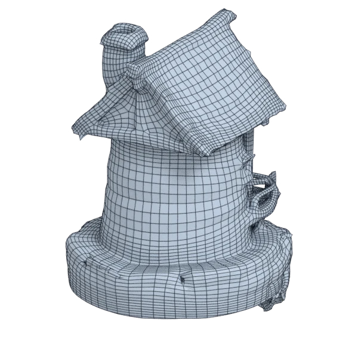
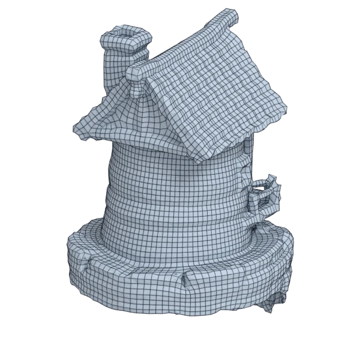

# towermill

An extra model; 14 998 triangles in the source.
Author, source and licence: [CREDITS.md](../../CREDITS.md).

## At 3000 quads asked for

| Source | QuadriFlow (Blender) | AutoRemesher | openclare | Quad Remesher |
|---|---|---|---|---|
|  |  |  |  |  |
| 14 998 triangles | 2 755 quads | 1 088 quads | 2 393 quads | 16 107 quads |

## At equal quad count

Quad Remesher makes more quads than the 3000 it is asked for. Next to its mesh, openclare asked for as many quads as that mesh has.

| Quad Remesher | openclare, as many quads |
|---|---|
|  |  |
| 16 107 quads | 12 835 quads |

## Edge loops

At 3000 quads asked for. Each loop is followed straight on through every regular vertex: it closes, comes back beside itself a quad further (a spiral), stops at an irregular vertex, or runs from a border to a border. Share of the edges on each, those of borders and of faces that are not quads left out; "—" where the mesh is not a manifold.

| | closed | spiral | stops | border to border | spirals | longest that stops |
|---|---|---|---|---|---|---|
| QuadriFlow (Blender) | 1 % | 11 % | 88 % | 0 % | 20 | 61 |
| AutoRemesher | — | — | — | — | — | — |
| openclare | — | — | — | — | — | — |
| Quad Remesher | — | — | — | — | — | — |

## Marks

From 0 to 100; how they are made is in [SCORES.md](../../bench/results/SCORES.md).

### 1000 quads

| Remesher | Quads | Overall | Validity | Alignment | Quad shape | Fidelity | Regularity | Structure | Edge loops | Budget | Speed |
|---|---|---|---|---|---|---|---|---|---|---|---|
| quadremesher | 6083 | **30** | 0 | 57 | 50 | 64 | 17 | — | 13 | 0 | 0 |
| quadriflow | 866 | **22** | 0 | 40 | 28 | 27 | 0 | 2 | 30 | 46 | 100 |
| openclare-uniform | 1826 | **19** | 0 | 25 | 0 | 31 | 96 | 0 | — | 0 | 24 |
| **openclare** | 685 | **14** | 0 | 34 | 23 | 19 | 0 | — | — | 0 | 43 |
| autoremesher | 405 | **4** | 0 | 19 | 0 | 0 | 0 | — | — | 0 | 96 |

### 3000 quads

| Remesher | Quads | Overall | Validity | Alignment | Quad shape | Fidelity | Regularity | Structure | Edge loops | Budget | Speed |
|---|---|---|---|---|---|---|---|---|---|---|---|
| openclare-uniform | 2969 | **35** | 0 | 36 | 29 | 29 | 92 | 4 | — | 96 | 41 |
| quadremesher | 16107 | **35** | 0 | 53 | 55 | 61 | 50 | — | — | 0 | 0 |
| quadremesher-uniform | 2897 | **34** | 0 | 48 | 53 | 37 | 0 | — | — | 86 | 0 |
| **openclare** | 2393 | **27** | 0 | 43 | 51 | 22 | 41 | — | — | 19 | 19 |
| integer-grid | 2395 | **27** | 0 | 43 | 51 | 22 | 39 | — | — | 19 | 38 |
| quadriflow | 2724 | **26** | 0 | 41 | 40 | 34 | 0 | 2 | 23 | 63 | 72 |
| instant-meshes | 1904 | **8** | 0 | 28 | 3 | 16 | 0 | 0 | — | 0 | 100 |
| autoremesher | 1088 | **6** | 0 | 28 | 3 | 0 | 0 | — | — | 0 | 85 |

At equal quad count: Quad Remesher's mesh as it is, and openclare asked for as many quads.

| Remesher | Quads | Overall | Validity | Alignment | Quad shape | Fidelity | Regularity | Structure | Edge loops | Budget | Speed |
|---|---|---|---|---|---|---|---|---|---|---|---|
| openclare-matched | 12835 | **37** | 0 | 46 | 63 | 43 | 68 | — | — | 19 | 0 |
| quadremesher-as-made | 16107 | **35** | 0 | 48 | 55 | 47 | 50 | — | — | 100 | 0 |

### 8000 quads

| Remesher | Quads | Overall | Validity | Alignment | Quad shape | Fidelity | Regularity | Structure | Edge loops | Budget | Speed |
|---|---|---|---|---|---|---|---|---|---|---|---|
| quadremesher | 35806 | **37** | 0 | 55 | 61 | 73 | 68 | — | 13 | 0 | 0 |
| openclare-uniform | 6213 | **32** | 0 | 51 | 57 | 34 | 53 | — | — | 11 | 0 |
| quadriflow | 7180 | **30** | 0 | 49 | 54 | 49 | 13 | 3 | 4 | 59 | 52 |
| autoremesher | 2664 | **11** | 0 | 36 | 9 | 10 | 0 | — | — | 0 | 65 |
| **openclare** | — | **0** | 0 | — | — | — | — | — | — | — | — |
