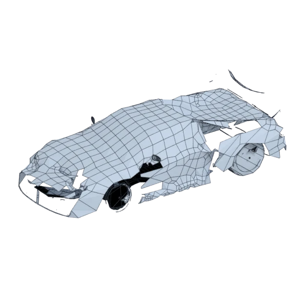

# venturi

An extra model; 40 764 triangles in the source.
Author, source and licence: [CREDITS.md](../../CREDITS.md).

## At 3000 quads asked for

| Source | AutoRemesher | openclare | Quad Remesher |
|---|---|---|---|
|  |  |  |  |
| 40 764 triangles | 4 046 quads | 3 050 quads | 14 193 quads |

## At equal quad count

Quad Remesher makes more quads than the 3000 it is asked for. Next to its mesh, openclare asked for as many quads as that mesh has.

| Quad Remesher | openclare, as many quads |
|---|---|
|  |  |
| 14 193 quads | 14 233 quads |

## Edge loops

At 3000 quads asked for. Each loop is followed straight on through every regular vertex: it closes, comes back beside itself a quad further (a spiral), stops at an irregular vertex, or runs from a border to a border. Share of the edges on each, those of borders and of faces that are not quads left out; "—" where the mesh is not a manifold.

| | closed | spiral | stops | border to border | spirals | longest that stops |
|---|---|---|---|---|---|---|
| Modelled by hand | — | — | — | — | — | — |
| QuadriFlow (Blender) | — | — | — | — | — | — |
| AutoRemesher | — | — | — | — | — | — |
| openclare | 10 % | 25 % | 65 % | 0 % | 71 | 119 |
| Quad Remesher | 6 % | 3 % | 29 % | 61 % | 18 | 112 |

## Marks

From 0 to 100; how they are made is in [SCORES.md](../../bench/results/SCORES.md).

### 1000 quads

| Remesher | Quads | Overall | Validity | Alignment | Quad shape | Fidelity | Regularity | Structure | Edge loops | Budget | Speed |
|---|---|---|---|---|---|---|---|---|---|---|---|
| quadremesher | 12157 | **59** | 0 | 100 | 88 | 84 | 100 | — | — | 0 | 53 |
| quadremesher-uniform | 8690 | **54** | 0 | 100 | 85 | 70 | 83 | — | — | 0 | 67 |
| openclare-uniform | 757 | **31** | 0 | 77 | 77 | 29 | 0 | — | 18 | 3 | 54 |
| integer-grid | 742 | **28** | 0 | 56 | 89 | 15 | 0 | — | — | 0 | 50 |
| **openclare** | 836 | **28** | 0 | 61 | 65 | 27 | 0 | — | 9 | 34 | 46 |
| autoremesher | 2390 | **23** | 0 | 96 | 0 | 18 | 0 | — | — | 0 | 100 |
| instant-meshes | 639 | **23** | 0 | 66 | 43 | 11 | 0 | 28 | — | 0 | 100 |
| quadriflow | — | **0** | 0 | — | — | — | — | — | — | — | — |

Lines of the scene, as openclare reports them: 16 edges laid along the guide curves and the borders between materials, 348 faces left across a border, lines let go on 5 pieces.

At equal quad count: Quad Remesher's mesh as it is, and openclare asked for as many quads.

| Remesher | Quads | Overall | Validity | Alignment | Quad shape | Fidelity | Regularity | Structure | Edge loops | Budget | Speed |
|---|---|---|---|---|---|---|---|---|---|---|---|
| quadremesher-as-made | 12157 | **65** | 0 | 97 | 88 | 82 | 100 | — | — | 100 | 53 |
| openclare-matched | 12464 | **48** | 0 | 78 | 100 | 56 | 80 | 21 | 15 | 90 | 0 |

### 3000 quads

| Remesher | Quads | Overall | Validity | Alignment | Quad shape | Fidelity | Regularity | Structure | Edge loops | Budget | Speed |
|---|---|---|---|---|---|---|---|---|---|---|---|
| openclare-uniform | 2721 | **68** | 96 | 77 | 97 | 25 | 74 | — | 21 | 63 | 38 |
| quadremesher | 14193 | **59** | 0 | 100 | 94 | 84 | 100 | — | 56 | 0 | 58 |
| **openclare** | 3050 | **59** | 97 | 62 | 80 | 29 | 16 | — | 6 | 93 | 29 |
| quadremesher-uniform | 9910 | **57** | 0 | 100 | 92 | 79 | 88 | — | — | 0 | 65 |
| integer-grid | 2412 | **46** | 0 | 76 | 99 | 25 | 80 | — | — | 22 | 24 |
| instant-meshes | 2489 | **34** | 0 | 74 | 66 | 31 | 0 | 41 | — | 32 | 99 |
| autoremesher | 4046 | **20** | 0 | 74 | 0 | 26 | 0 | — | — | 0 | 87 |
| quadriflow | — | **0** | 0 | — | — | — | — | — | — | — | 100 |

Lines of the scene, as openclare reports them: 29 edges laid along the guide curves and the borders between materials, 845 faces left across a border, lines let go on 6 pieces.

At equal quad count: Quad Remesher's mesh as it is, and openclare asked for as many quads.

| Remesher | Quads | Overall | Validity | Alignment | Quad shape | Fidelity | Regularity | Structure | Edge loops | Budget | Speed |
|---|---|---|---|---|---|---|---|---|---|---|---|
| openclare-matched | 14233 | **76** | 99 | 83 | 100 | 53 | 91 | — | 16 | 99 | 0 |
| quadremesher-as-made | 14193 | **66** | 0 | 98 | 94 | 83 | 100 | — | — | 100 | 58 |

### 8000 quads

| Remesher | Quads | Overall | Validity | Alignment | Quad shape | Fidelity | Regularity | Structure | Edge loops | Budget | Speed |
|---|---|---|---|---|---|---|---|---|---|---|---|
| integer-grid | 6950 | **79** | 99 | 84 | 100 | 24 | 100 | — | — | 48 | 0 |
| openclare-uniform | 7585 | **76** | 100 | 84 | 100 | 36 | 100 | 31 | 37 | 79 | 4 |
| quadremesher | 19704 | **61** | 0 | 100 | 100 | 84 | 100 | — | 63 | 0 | 60 |
| quadremesher-uniform | 14699 | **60** | 0 | 100 | 98 | 82 | 100 | — | — | 0 | 57 |
| instant-meshes | 7693 | **50** | 0 | 78 | 86 | 57 | 23 | 45 | — | 85 | 91 |
| **openclare** | 8376 | **44** | 0 | 74 | 95 | 38 | 44 | 27 | 13 | 81 | 12 |
| autoremesher | 7212 | **30** | 0 | 85 | 0 | 34 | 0 | — | — | 61 | 85 |
| quadriflow | — | **0** | 0 | — | — | — | — | — | — | — | — |

Lines of the scene, as openclare reports them: 77 edges laid along the guide curves and the borders between materials, 1493 faces left across a border, lines let go on 6 pieces.

At equal quad count: Quad Remesher's mesh as it is, and openclare asked for as many quads.

| Remesher | Quads | Overall | Validity | Alignment | Quad shape | Fidelity | Regularity | Structure | Edge loops | Budget | Speed |
|---|---|---|---|---|---|---|---|---|---|---|---|
| openclare-matched | 19042 | **77** | 100 | 89 | 100 | 59 | 100 | 25 | 20 | 87 | 0 |
| quadremesher-as-made | 19704 | **67** | 0 | 98 | 100 | 83 | 100 | — | — | 100 | 60 |
