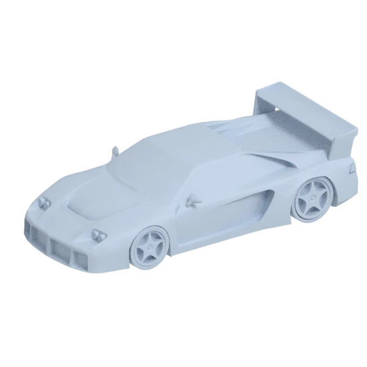
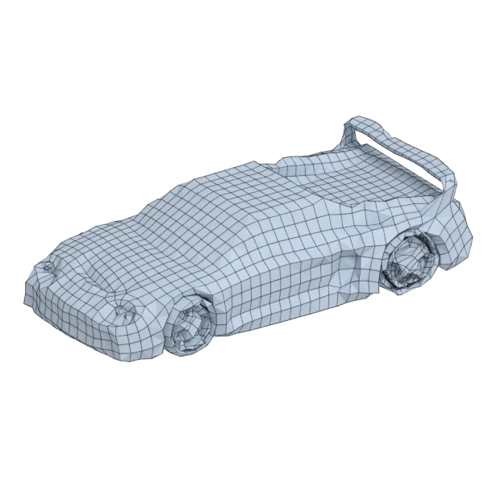
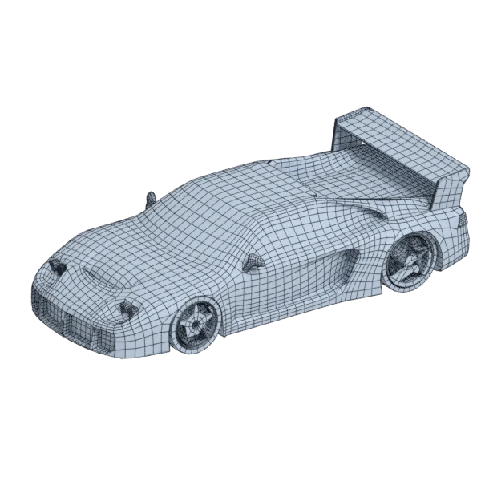
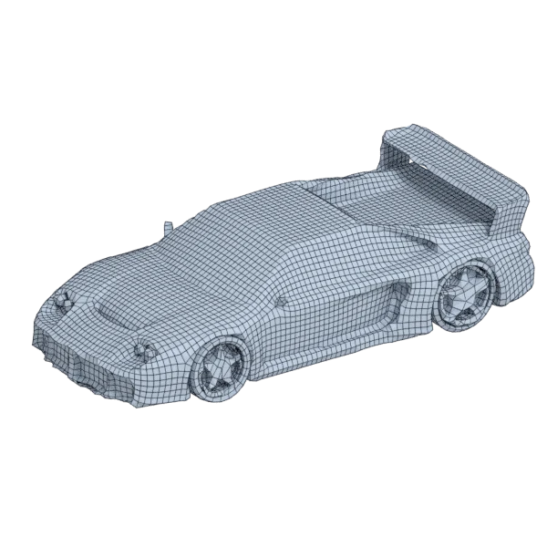

# venturi

An extra model; 40 764 triangles in the source.
Author, source and licence: [CREDITS.md](../../CREDITS.md).

## At 3000 quads asked for

| Source | openclare | Quad Remesher |
|---|---|---|
|  |  |  |
| 40 764 triangles | 3 049 quads | 14 193 quads |

## At equal quad count

Quad Remesher makes more quads than the 3000 it is asked for. Next to its mesh, openclare asked for as many quads as that mesh has.

| Quad Remesher | openclare, as many quads |
|---|---|
|  |  |
| 14 193 quads | 14 282 quads |

## Marks

From 0 to 100; how they are made is in [SCORES.md](../../bench/results/SCORES.md).

### 1000 quads

| Remesher | Quads | Overall | Validity | Alignment | Quad shape | Fidelity | Regularity | Structure | Budget | Speed |
|---|---|---|---|---|---|---|---|---|---|---|
| quadremesher | 12157 | **41** | 0 | 69 | 50 | 84 | 50 | — | 0 | 53 |
| quadremesher-uniform | 8690 | **37** | 0 | 71 | 47 | 70 | 33 | — | 0 | 67 |
| openclare-uniform | 757 | **22** | 0 | 50 | 41 | 29 | 0 | — | 3 | 47 |
| **openclare** | 836 | **21** | 0 | 39 | 30 | 27 | 0 | — | 34 | 41 |
| integer-grid | 742 | **18** | 0 | 36 | 51 | 15 | 0 | — | 0 | 50 |
| instant-meshes | 639 | **13** | 0 | 43 | 12 | 11 | 0 | 28 | 0 | 100 |
| quadriflow | — | **0** | 0 | — | — | — | — | — | — | — |

Lines of the scene, as openclare reports them: 16 edges laid along the guide curves and the borders between materials, 348 faces left across a border, lines let go on 5 pieces.

At equal quad count: Quad Remesher's mesh as it is, and openclare asked for as many quads.

| Remesher | Quads | Overall | Validity | Alignment | Quad shape | Fidelity | Regularity | Structure | Budget | Speed |
|---|---|---|---|---|---|---|---|---|---|---|
| quadremesher-as-made | 12157 | **44** | 0 | 63 | 50 | 82 | 50 | — | 100 | 53 |
| openclare-matched | 12482 | **35** | 0 | 51 | 61 | 56 | 30 | 16 | 89 | 0 |

### 3000 quads

| Remesher | Quads | Overall | Validity | Alignment | Quad shape | Fidelity | Regularity | Structure | Budget | Speed |
|---|---|---|---|---|---|---|---|---|---|---|
| quadremesher | 14193 | **42** | 0 | 69 | 55 | 84 | 57 | — | 0 | 58 |
| quadremesher-uniform | 9910 | **40** | 0 | 70 | 53 | 79 | 38 | — | 0 | 65 |
| openclare-uniform | 2721 | **33** | 0 | 49 | 57 | 25 | 24 | — | 63 | 41 |
| **openclare** | 3049 | **30** | 0 | 40 | 43 | 29 | 0 | — | 93 | 27 |
| integer-grid | 2412 | **29** | 0 | 49 | 59 | 25 | 30 | — | 22 | 24 |
| instant-meshes | 2489 | **24** | 0 | 47 | 31 | 31 | 0 | 41 | 32 | 99 |
| quadriflow | — | **0** | 0 | — | — | — | — | — | — | — |

Lines of the scene, as openclare reports them: 29 edges laid along the guide curves and the borders between materials, 846 faces left across a border, lines let go on 6 pieces.

At equal quad count: Quad Remesher's mesh as it is, and openclare asked for as many quads.

| Remesher | Quads | Overall | Validity | Alignment | Quad shape | Fidelity | Regularity | Structure | Budget | Speed |
|---|---|---|---|---|---|---|---|---|---|---|
| quadremesher-as-made | 14193 | **46** | 0 | 63 | 55 | 83 | 57 | — | 100 | 58 |
| openclare-matched | 14282 | **39** | 0 | 54 | 66 | 53 | 41 | — | 97 | 0 |

### 8000 quads

| Remesher | Quads | Overall | Validity | Alignment | Quad shape | Fidelity | Regularity | Structure | Budget | Speed |
|---|---|---|---|---|---|---|---|---|---|---|
| openclare-uniform | 7574 | **67** | 100 | 54 | 68 | 36 | 63 | 31 | 79 | 1 |
| quadremesher | 19704 | **44** | 0 | 67 | 60 | 84 | 65 | — | 0 | 60 |
| quadremesher-uniform | 14699 | **42** | 0 | 69 | 58 | 82 | 53 | — | 0 | 57 |
| integer-grid | 6950 | **37** | 0 | 54 | 67 | 24 | 61 | — | 48 | 0 |
| instant-meshes | 7693 | **37** | 0 | 50 | 48 | 57 | 0 | 45 | 85 | 91 |
| **openclare** | 8352 | **33** | 0 | 47 | 56 | 38 | 0 | 27 | 82 | 9 |
| quadriflow | — | **0** | 0 | — | — | — | — | — | — | — |

Lines of the scene, as openclare reports them: 71 edges laid along the guide curves and the borders between materials, 1470 faces left across a border, lines let go on 6 pieces.

At equal quad count: Quad Remesher's mesh as it is, and openclare asked for as many quads.

| Remesher | Quads | Overall | Validity | Alignment | Quad shape | Fidelity | Regularity | Structure | Budget | Speed |
|---|---|---|---|---|---|---|---|---|---|---|
| openclare-matched | 19050 | **70** | 100 | 57 | 71 | 59 | 61 | 25 | 87 | 0 |
| quadremesher-as-made | 19704 | **48** | 0 | 63 | 60 | 83 | 65 | — | 100 | 60 |
