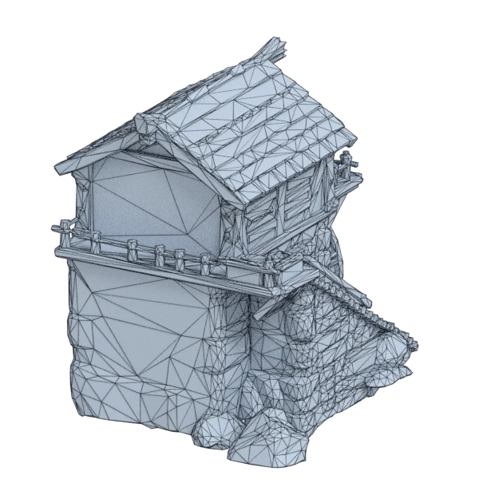
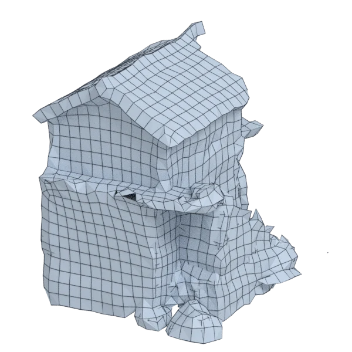
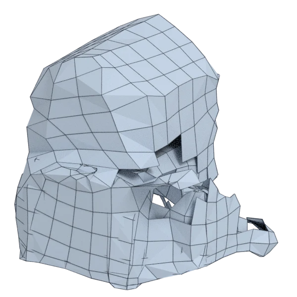
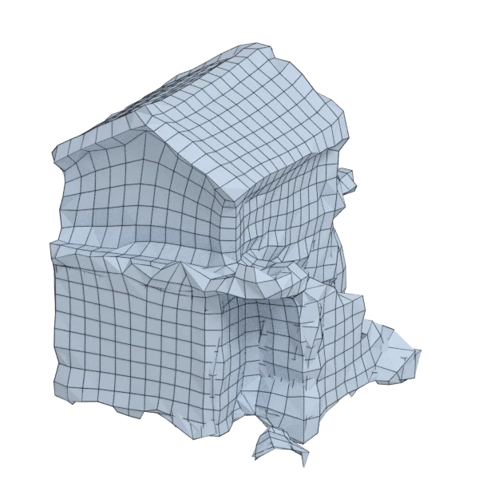
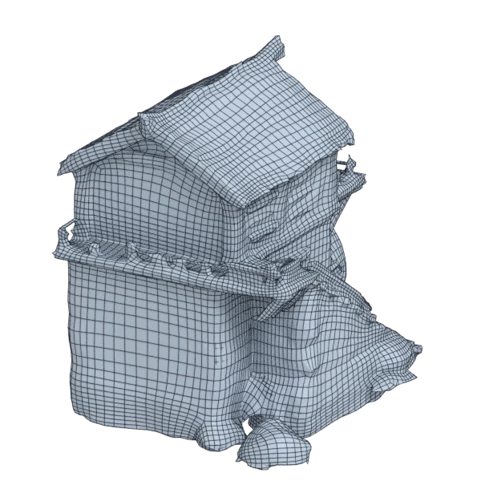

# watermill

An extra model; 14 934 triangles in the source.
Author, source and licence: [CREDITS.md](../../CREDITS.md).

## At 3000 quads asked for

| Source | QuadriFlow (Blender) | AutoRemesher | openclare | Quad Remesher |
|---|---|---|---|---|
|  |  |  |  |  |
| 14 934 triangles | 2 721 quads | 709 quads | 2 241 quads | 22 110 quads |

## Edge loops

At 3000 quads asked for. Each loop is followed straight on through every regular vertex: it closes, comes back beside itself a quad further (a spiral), stops at an irregular vertex, or runs from a border to a border. Share of the edges on each, those of borders and of faces that are not quads left out; "—" where the mesh is not a manifold.

| | closed | spiral | stops | border to border | spirals | longest that stops |
|---|---|---|---|---|---|---|
| Modelled by hand | — | — | — | — | — | — |
| QuadriFlow (Blender) | 2 % | 7 % | 89 % | 3 % | 27 | 76 |
| AutoRemesher | — | — | — | — | — | — |
| openclare | — | — | — | — | — | — |
| Quad Remesher | 5 % | 9 % | 86 % | 0 % | 75 | 228 |

## Marks

From 0 to 100; how they are made is in [SCORES.md](../../bench/results/SCORES.md).

### 1000 quads

| Remesher | Quads | Overall | Validity | Alignment | Quad shape | Fidelity | Regularity | Structure | Edge loops | Budget | Speed |
|---|---|---|---|---|---|---|---|---|---|---|---|
| quadremesher | 9441 | **43** | 0 | 74 | 88 | 52 | 57 | — | — | 0 | 0 |
| quadriflow | 763 | **21** | 0 | 43 | 53 | 2 | 0 | 2 | 42 | 5 | 100 |
| openclare-uniform | 390 | **11** | 0 | 33 | 26 | 1 | 0 | — | — | 0 | 45 |
| **openclare** | 390 | **11** | 0 | 32 | 26 | 1 | 0 | — | — | 0 | 39 |
| autoremesher | 225 | **5** | 0 | 22 | 0 | 0 | 0 | — | — | 0 | 89 |

### 3000 quads

| Remesher | Quads | Overall | Validity | Alignment | Quad shape | Fidelity | Regularity | Structure | Edge loops | Budget | Speed |
|---|---|---|---|---|---|---|---|---|---|---|---|
| quadremesher | 22110 | **50** | 0 | 80 | 100 | 54 | 93 | — | 45 | 0 | 0 |
| quadriflow | 2675 | **36** | 0 | 54 | 79 | 19 | 37 | 3 | 39 | 57 | 73 |
| quadremesher-uniform | 2850 | **35** | 0 | 51 | 79 | 24 | 0 | — | — | 80 | 0 |
| **openclare** | 2241 | **32** | 0 | 47 | 81 | 13 | 66 | — | — | 0 | 0 |
| openclare-uniform | 2249 | **31** | 0 | 47 | 80 | 13 | 57 | — | — | 0 | 0 |
| integer-grid | 2260 | **29** | 0 | 47 | 77 | 10 | 50 | — | — | 1 | 23 |
| instant-meshes | 1784 | **17** | 0 | 42 | 46 | 7 | 0 | 6 | — | 0 | 100 |
| autoremesher | 709 | **8** | 0 | 19 | 22 | 0 | 0 | — | — | 0 | 84 |

At equal quad count: Quad Remesher's mesh as it is, and openclare asked for as many quads.

| Remesher | Quads | Overall | Validity | Alignment | Quad shape | Fidelity | Regularity | Structure | Edge loops | Budget | Speed |
|---|---|---|---|---|---|---|---|---|---|---|---|
| quadremesher-as-made | 22110 | **51** | 0 | 72 | 100 | 31 | 93 | — | — | 100 | 0 |
| openclare-matched | — | **0** | 0 | — | — | — | — | — | — | — | — |

### 8000 quads

| Remesher | Quads | Overall | Validity | Alignment | Quad shape | Fidelity | Regularity | Structure | Edge loops | Budget | Speed |
|---|---|---|---|---|---|---|---|---|---|---|---|
| quadremesher | 42790 | **53** | 0 | 85 | 100 | 57 | 100 | — | — | 0 | 0 |
| openclare-uniform | 6612 | **44** | 0 | 64 | 99 | 17 | 89 | — | — | 31 | 0 |
| **openclare** | 6616 | **44** | 0 | 64 | 98 | 17 | 90 | — | — | 31 | 0 |
| quadriflow | 7305 | **42** | 0 | 63 | 93 | 27 | 62 | 4 | 28 | 65 | 51 |
| autoremesher | 2507 | **12** | 0 | 40 | 22 | 0 | 0 | — | — | 0 | 62 |
