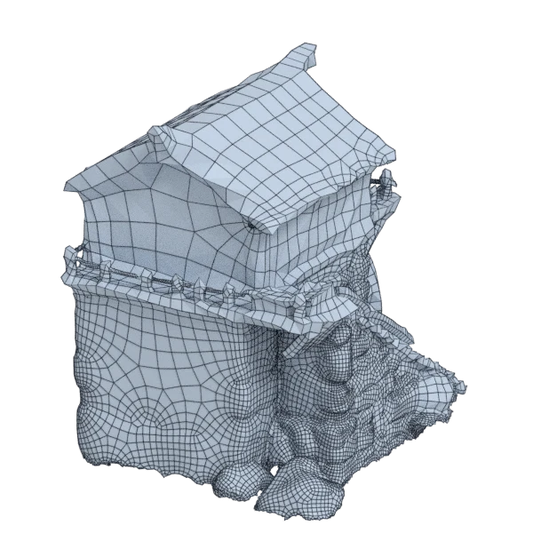

# watermill

An extra model; 14 934 triangles in the source.
Author, source and licence: [CREDITS.md](../../CREDITS.md).

## At 3000 quads asked for

| Source | QuadriFlow (Blender) | AutoRemesher | openclare | Quad Remesher |
|---|---|---|---|---|
|  |  |  |  |  |
| 14 934 triangles | 2 721 quads | 709 quads | 2 193 quads | 22 110 quads |

## At equal quad count

Quad Remesher makes more quads than the 3000 it is asked for. Next to its mesh, openclare asked for as many quads as that mesh has.

| Quad Remesher | openclare, as many quads |
|---|---|
|  |  |
| 22 110 quads | 21 770 quads |

## Edge loops

At 3000 quads asked for. Each loop is followed straight on through every regular vertex: it closes, comes back beside itself a quad further (a spiral), stops at an irregular vertex, or runs from a border to a border. Share of the edges on each, those of borders and of faces that are not quads left out; "—" where the mesh is not a manifold.

| | closed | spiral | stops | border to border | spirals | longest that stops |
|---|---|---|---|---|---|---|
| QuadriFlow (Blender) | 2 % | 7 % | 89 % | 3 % | 27 | 76 |
| AutoRemesher | — | — | — | — | — | — |
| openclare | — | — | — | — | — | — |
| Quad Remesher | 5 % | 9 % | 86 % | 0 % | 75 | 228 |

## Marks

From 0 to 100; how they are made is in [SCORES.md](../../bench/results/SCORES.md).

### 1000 quads

| Remesher | Quads | Overall | Validity | Alignment | Quad shape | Fidelity | Regularity | Structure | Edge loops | Budget | Speed |
|---|---|---|---|---|---|---|---|---|---|---|---|
| quadremesher | 9441 | **27** | 0 | 48 | 49 | 52 | 7 | — | — | 0 | 0 |
| quadriflow | 763 | **12** | 0 | 28 | 20 | 2 | 0 | 2 | 36 | 5 | 100 |
| openclare-uniform | 592 | **10** | 0 | 27 | 17 | 10 | 0 | — | — | 0 | 43 |
| **openclare** | 592 | **10** | 0 | 27 | 16 | 10 | 0 | — | — | 0 | 41 |
| autoremesher | 225 | **3** | 0 | 14 | 0 | 0 | 0 | — | — | 0 | 89 |

### 3000 quads

| Remesher | Quads | Overall | Validity | Alignment | Quad shape | Fidelity | Regularity | Structure | Edge loops | Budget | Speed |
|---|---|---|---|---|---|---|---|---|---|---|---|
| quadremesher | 22110 | **33** | 0 | 52 | 60 | 54 | 43 | — | 34 | 0 | 0 |
| quadremesher-uniform | 2850 | **26** | 0 | 33 | 42 | 24 | 0 | — | — | 80 | 0 |
| quadriflow | 2675 | **23** | 0 | 35 | 42 | 19 | 0 | 3 | 34 | 57 | 73 |
| **openclare** | 2193 | **19** | 0 | 34 | 47 | 10 | 26 | — | — | 0 | 0 |
| openclare-uniform | 2189 | **19** | 0 | 35 | 47 | 10 | 23 | — | — | 0 | 0 |
| integer-grid | 2260 | **14** | 0 | 30 | 40 | 10 | 0 | — | — | 1 | 23 |
| instant-meshes | 1784 | **9** | 0 | 27 | 14 | 7 | 0 | 6 | — | 0 | 100 |
| autoremesher | 709 | **3** | 0 | 12 | 0 | 0 | 0 | — | — | 0 | 84 |

At equal quad count: Quad Remesher's mesh as it is, and openclare asked for as many quads.

| Remesher | Quads | Overall | Validity | Alignment | Quad shape | Fidelity | Regularity | Structure | Edge loops | Budget | Speed |
|---|---|---|---|---|---|---|---|---|---|---|---|
| quadremesher-as-made | 22110 | **32** | 0 | 46 | 60 | 31 | 43 | — | — | 100 | 0 |
| openclare-matched | — | **0** | 0 | — | — | — | — | — | — | — | — |

### 8000 quads

| Remesher | Quads | Overall | Validity | Alignment | Quad shape | Fidelity | Regularity | Structure | Edge loops | Budget | Speed |
|---|---|---|---|---|---|---|---|---|---|---|---|
| quadremesher | 42790 | **37** | 0 | 55 | 63 | 57 | 65 | — | — | 0 | 0 |
| openclare-uniform | 6743 | **29** | 0 | 42 | 60 | 17 | 37 | — | — | 37 | 0 |
| **openclare** | 6739 | **29** | 0 | 42 | 59 | 17 | 37 | — | — | 37 | 0 |
| quadriflow | 7305 | **28** | 0 | 41 | 54 | 27 | 12 | 4 | 23 | 65 | 51 |
| autoremesher | 2507 | **5** | 0 | 26 | 0 | 0 | 0 | — | — | 0 | 62 |
