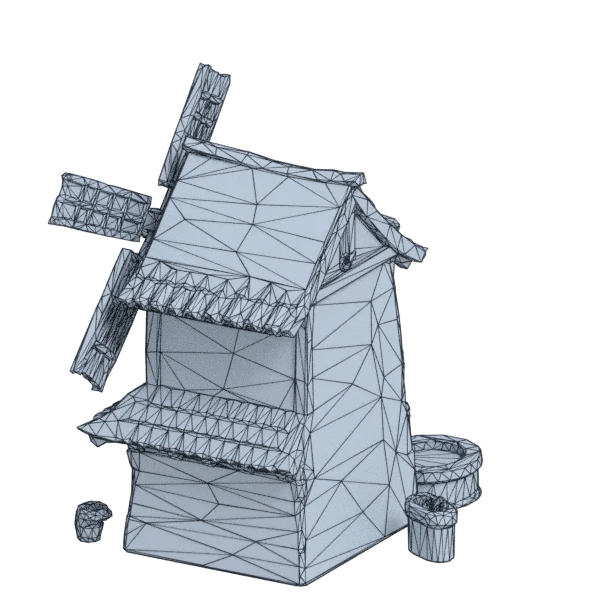
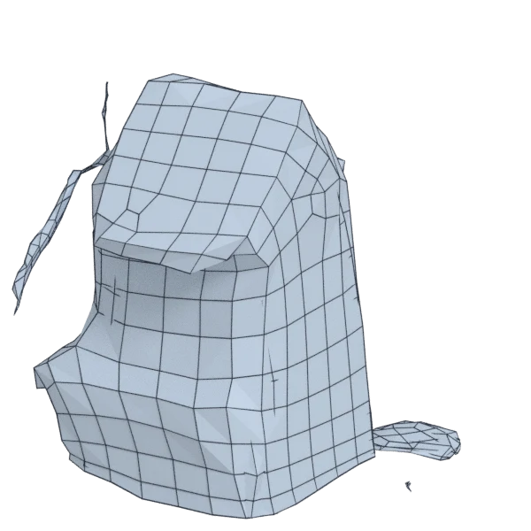
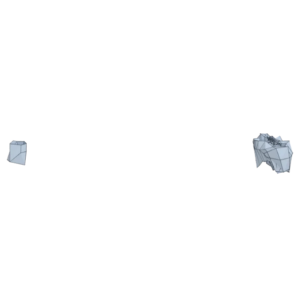
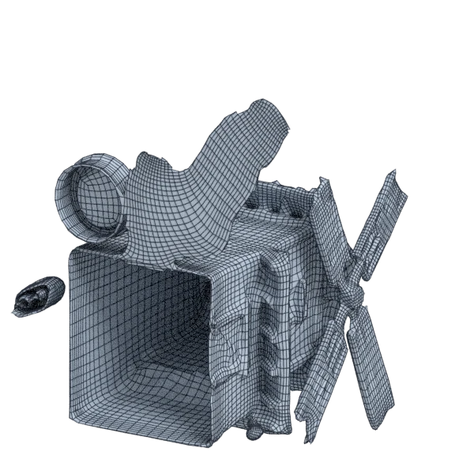
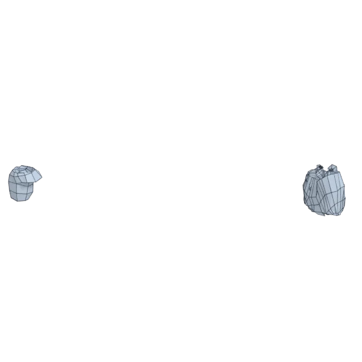

# windmill

An extra model; 14 962 triangles in the source.
Author, source and licence: [CREDITS.md](../../CREDITS.md).

## At 3000 quads asked for

| Source | AutoRemesher | openclare | Quad Remesher |
|---|---|---|---|
|  |  |  |  |
| 14 962 triangles | 1 003 quads | 349 quads | 17 287 quads |

## At equal quad count

Quad Remesher makes more quads than the 3000 it is asked for. Next to its mesh, openclare asked for as many quads as that mesh has.

| Quad Remesher | openclare, as many quads |
|---|---|
|  |  |
| 17 287 quads | 753 quads |

## Edge loops

At 3000 quads asked for. Each loop is followed straight on through every regular vertex: it closes, comes back beside itself a quad further (a spiral), stops at an irregular vertex, or runs from a border to a border. Share of the edges on each, those of borders and of faces that are not quads left out; "—" where the mesh is not a manifold.

| | closed | spiral | stops | border to border | spirals | longest that stops |
|---|---|---|---|---|---|---|
| QuadriFlow (Blender) | — | — | — | — | — | — |
| AutoRemesher | — | — | — | — | — | — |
| openclare | 0 % | 1 % | 99 % | 0 % | 1 | 25 |
| Quad Remesher | 8 % | 3 % | 90 % | 0 % | 11 | 387 |

## Marks

From 0 to 100; how they are made is in [SCORES.md](../../bench/results/SCORES.md).

### 1000 quads

| Remesher | Quads | Overall | Validity | Alignment | Quad shape | Fidelity | Regularity | Structure | Budget | Speed |
|---|---|---|---|---|---|---|---|---|---|---|
| openclare-uniform | 141 | **11** | 0 | 20 | 0 | 0 | 72 | 0 | 0 | 100 |
| autoremesher | 370 | **8** | 0 | 36 | 0 | 0 | 0 | — | 0 | 100 |
| **openclare** | 164 | **4** | 0 | 5 | 0 | 0 | 27 | 0 | 0 | 97 |

### 3000 quads

| Remesher | Quads | Overall | Validity | Alignment | Quad shape | Fidelity | Regularity | Structure | Budget | Speed |
|---|---|---|---|---|---|---|---|---|---|---|
| quadremesher | 17287 | **38** | 0 | 58 | 58 | 75 | 48 | — | 0 | 0 |
| quadremesher-uniform | 2787 | **32** | 0 | 48 | 47 | 46 | 0 | — | 72 | 0 |
| openclare-uniform | 207 | **11** | 0 | 15 | 0 | 0 | 81 | 4 | 0 | 90 |
| instant-meshes | 1886 | **11** | 0 | 31 | 24 | 7 | 0 | 6 | 0 | 100 |
| autoremesher | 1003 | **8** | 0 | 36 | 0 | 0 | 0 | — | 0 | 94 |
| **openclare** | 349 | **3** | 0 | 16 | 0 | 0 | 0 | 0 | 0 | 90 |
| quadriflow | — | **0** | 0 | — | — | — | — | — | — | — |
| integer-grid | — | **0** | 0 | — | — | — | — | — | — | — |

At equal quad count: Quad Remesher's mesh as it is, and openclare asked for as many quads.

| Remesher | Quads | Overall | Validity | Alignment | Quad shape | Fidelity | Regularity | Structure | Budget | Speed |
|---|---|---|---|---|---|---|---|---|---|---|
| quadremesher-as-made | 17287 | **39** | 0 | 48 | 58 | 65 | 48 | — | 100 | 0 |
| openclare-matched | 753 | **6** | 0 | 24 | 4 | 0 | 0 | 1 | 0 | 48 |

### 8000 quads

| Remesher | Quads | Overall | Validity | Alignment | Quad shape | Fidelity | Regularity | Structure | Budget | Speed |
|---|---|---|---|---|---|---|---|---|---|---|
| **openclare** | 439 | **28** | 100 | 16 | 0 | 0 | 0 | 0 | 0 | 62 |
| autoremesher | 2364 | **13** | 0 | 41 | 30 | 0 | 1 | — | 0 | 73 |
| openclare-uniform | 263 | **10** | 0 | 21 | 0 | 0 | 54 | 9 | 0 | 76 |
