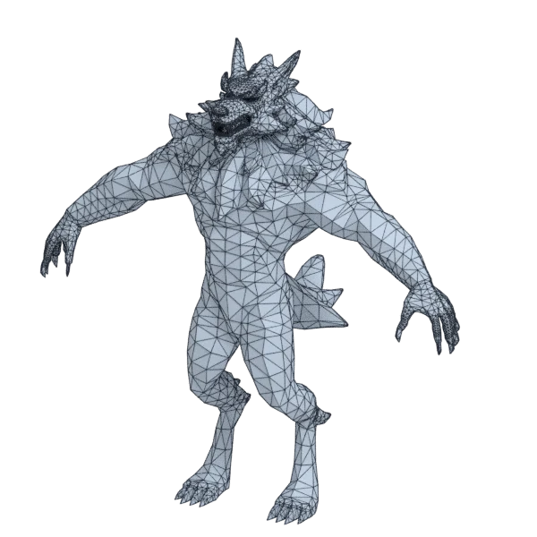
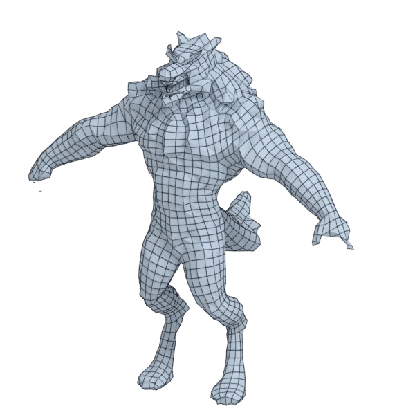
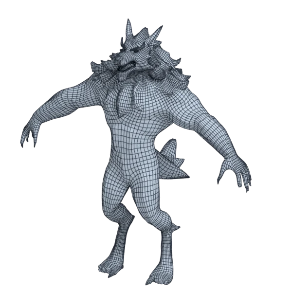
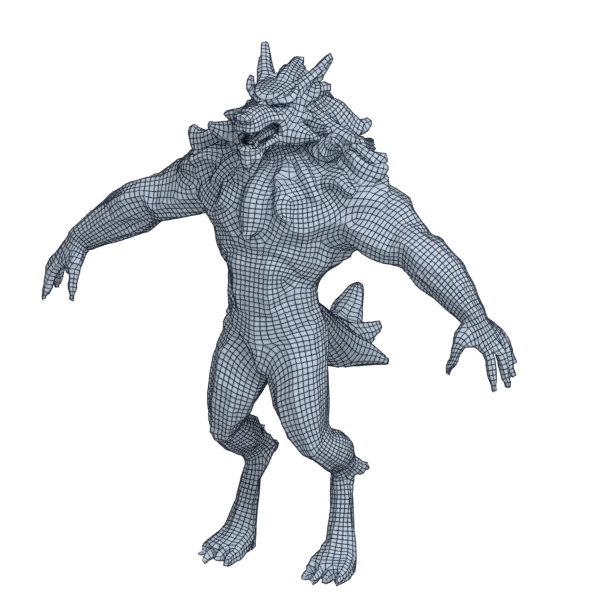

# wolf

An extra model, with open borders; 14 797 triangles in the source.
Its licence does not allow passing it on: the model is not in the repository (`make blenderkit`).
Author, source and licence: [CREDITS.md](../../CREDITS.md).

## At 3000 quads asked for

| Source | openclare | Quad Remesher |
|---|---|---|
|  |  |  |
| 14 797 triangles | 2 466 quads | 14 984 quads |

## At equal quad count

Quad Remesher makes more quads than the 3000 it is asked for. Next to its mesh, openclare asked for as many quads as that mesh has.

| Quad Remesher | openclare, as many quads |
|---|---|
|  |  |
| 14 984 quads | 13 011 quads |

## Marks

From 0 to 100; how they are made is in [SCORES.md](../../bench/results/SCORES.md).

### 1000 quads

| Remesher | Quads | Overall | Validity | Alignment | Quad shape | Fidelity | Regularity | Structure | Budget | Speed |
|---|---|---|---|---|---|---|---|---|---|---|
| openclare-uniform | 759 | **46** | 100 | 56 | 32 | 9 | 18 | 39 | 4 | 54 |
| **openclare** | 752 | **46** | 100 | 55 | 34 | 9 | 18 | 39 | 1 | 50 |
| quadremesher | 7098 | **29** | 0 | 60 | 50 | 55 | 0 | — | 0 | 19 |
| quadremesher-uniform | 803 | **20** | 0 | 54 | 35 | 5 | 0 | — | 21 | 12 |
| integer-grid | 744 | **18** | 0 | 55 | 37 | 2 | 1 | — | 0 | 57 |
| instant-meshes | 866 | **16** | 0 | 37 | 26 | 0 | 0 | 6 | 46 | 100 |
| quadriflow | — | **0** | 0 | — | — | — | — | — | — | — |

At equal quad count: Quad Remesher's mesh as it is, and openclare asked for as many quads.

| Remesher | Quads | Overall | Validity | Alignment | Quad shape | Fidelity | Regularity | Structure | Budget | Speed |
|---|---|---|---|---|---|---|---|---|---|---|
| openclare-matched | 5955 | **32** | 0 | 53 | 52 | 41 | 30 | — | 36 | 0 |
| quadremesher-as-made | 7098 | **25** | 0 | 53 | 50 | 22 | 0 | — | 100 | 19 |

### 3000 quads

| Remesher | Quads | Overall | Validity | Alignment | Quad shape | Fidelity | Regularity | Structure | Budget | Speed |
|---|---|---|---|---|---|---|---|---|---|---|
| quadremesher | 14984 | **36** | 0 | 59 | 53 | 61 | 48 | — | 0 | 20 |
| integer-grid | 2420 | **27** | 0 | 55 | 51 | 16 | 24 | — | 23 | 24 |
| **openclare** | 2466 | **24** | 0 | 51 | 45 | 13 | 9 | — | 29 | 16 |
| openclare-uniform | 2419 | **24** | 0 | 53 | 48 | 13 | 5 | — | 23 | 23 |
| instant-meshes | 2774 | **22** | 0 | 34 | 43 | 6 | 0 | 9 | 70 | 100 |
| quadremesher-uniform | 2308 | **22** | 0 | 56 | 44 | 12 | 0 | — | 8 | 17 |
| quadriflow | — | **0** | 0 | — | — | — | — | — | — | — |

At equal quad count: Quad Remesher's mesh as it is, and openclare asked for as many quads.

| Remesher | Quads | Overall | Validity | Alignment | Quad shape | Fidelity | Regularity | Structure | Budget | Speed |
|---|---|---|---|---|---|---|---|---|---|---|
| openclare-matched | 13011 | **37** | 0 | 53 | 51 | 54 | 53 | — | 47 | 0 |
| quadremesher-as-made | 14984 | **34** | 0 | 55 | 53 | 35 | 48 | — | 100 | 20 |

### 8000 quads

| Remesher | Quads | Overall | Validity | Alignment | Quad shape | Fidelity | Regularity | Structure | Budget | Speed |
|---|---|---|---|---|---|---|---|---|---|---|
| quadremesher | 28909 | **38** | 0 | 56 | 53 | 70 | 67 | — | 0 | 9 |
| openclare-uniform | 6760 | **36** | 0 | 54 | 53 | 53 | 38 | — | 38 | 0 |
| **openclare** | 6901 | **36** | 0 | 51 | 51 | 54 | 34 | — | 45 | 0 |
| integer-grid | 6579 | **33** | 0 | 55 | 54 | 37 | 42 | — | 29 | 0 |
| instant-meshes | 7656 | **26** | 0 | 31 | 55 | 19 | 5 | 4 | 83 | 97 |
| quadremesher-uniform | 6170 | **22** | 0 | 54 | 49 | 11 | 2 | — | 8 | 9 |
| quadriflow | — | **0** | 0 | — | — | — | — | — | — | 100 |

At equal quad count: Quad Remesher's mesh as it is, and openclare asked for as many quads.

| Remesher | Quads | Overall | Validity | Alignment | Quad shape | Fidelity | Regularity | Structure | Budget | Speed |
|---|---|---|---|---|---|---|---|---|---|---|
| openclare-matched | 25241 | **39** | 0 | 50 | 57 | 52 | 71 | — | 49 | 0 |
| quadremesher-as-made | 28909 | **37** | 0 | 51 | 53 | 44 | 67 | — | 100 | 9 |
