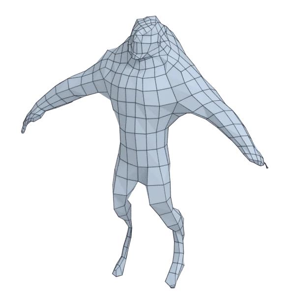

# wolf

An extra model, with open borders; 14 797 triangles in the source.
Its licence does not allow passing it on: the model is not in the repository (`make blenderkit`).
Author, source and licence: [CREDITS.md](../../CREDITS.md).

## At 3000 quads asked for

| Source | AutoRemesher | openclare | Quad Remesher |
|---|---|---|---|
|  |  |  |  |
| 14 797 triangles | 625 quads | 2 466 quads | 14 984 quads |

## At equal quad count

Quad Remesher makes more quads than the 3000 it is asked for. Next to its mesh, openclare asked for as many quads as that mesh has.

| Quad Remesher | openclare, as many quads |
|---|---|
|  |  |
| 14 984 quads | 13 011 quads |

## Edge loops

At 3000 quads asked for. Each loop is followed straight on through every regular vertex: it closes, comes back beside itself a quad further (a spiral), stops at an irregular vertex, or runs from a border to a border. Share of the edges on each, those of borders and of faces that are not quads left out; "—" where the mesh is not a manifold.

| | closed | spiral | stops | border to border | spirals | longest that stops |
|---|---|---|---|---|---|---|
| Modelled by hand | — | — | — | — | — | — |
| QuadriFlow (Blender) | — | — | — | — | — | — |
| AutoRemesher | — | — | — | — | — | — |
| openclare | 17 % | 13 % | 70 % | 0 % | 52 | 82 |
| Quad Remesher | 16 % | 7 % | 77 % | 0 % | 70 | 170 |

## Marks

From 0 to 100; how they are made is in [SCORES.md](../../bench/results/SCORES.md).

### 1000 quads

| Remesher | Quads | Overall | Validity | Alignment | Quad shape | Fidelity | Regularity | Structure | Edge loops | Budget | Speed |
|---|---|---|---|---|---|---|---|---|---|---|---|
| openclare-uniform | 759 | **62** | 100 | 86 | 67 | 9 | 68 | 39 | 59 | 4 | 54 |
| **openclare** | 752 | **62** | 100 | 85 | 70 | 9 | 68 | 39 | 57 | 1 | 58 |
| quadremesher | 7098 | **48** | 0 | 92 | 88 | 55 | 48 | — | 52 | 0 | 19 |
| integer-grid | 744 | **35** | 0 | 85 | 72 | 2 | 51 | — | — | 0 | 57 |
| quadremesher-uniform | 803 | **32** | 0 | 84 | 70 | 5 | 0 | — | — | 21 | 12 |
| instant-meshes | 866 | **26** | 0 | 58 | 60 | 0 | 0 | 6 | — | 46 | 100 |
| autoremesher | 180 | **14** | 0 | 56 | 5 | 0 | 0 | — | 21 | 0 | 100 |
| quadriflow | — | **0** | 0 | — | — | — | — | — | — | — | — |

At equal quad count: Quad Remesher's mesh as it is, and openclare asked for as many quads.

| Remesher | Quads | Overall | Validity | Alignment | Quad shape | Fidelity | Regularity | Structure | Edge loops | Budget | Speed |
|---|---|---|---|---|---|---|---|---|---|---|---|
| openclare-matched | 5955 | **51** | 0 | 82 | 91 | 41 | 80 | — | 44 | 36 | 0 |
| quadremesher-as-made | 7098 | **44** | 0 | 82 | 88 | 22 | 48 | — | — | 100 | 19 |

### 3000 quads

| Remesher | Quads | Overall | Validity | Alignment | Quad shape | Fidelity | Regularity | Structure | Edge loops | Budget | Speed |
|---|---|---|---|---|---|---|---|---|---|---|---|
| quadremesher | 14984 | **55** | 0 | 92 | 92 | 61 | 98 | — | 65 | 0 | 20 |
| integer-grid | 2420 | **45** | 0 | 85 | 90 | 16 | 74 | — | — | 23 | 24 |
| openclare-uniform | 2419 | **42** | 0 | 82 | 85 | 13 | 55 | — | 51 | 23 | 21 |
| **openclare** | 2466 | **42** | 0 | 79 | 82 | 13 | 59 | — | 48 | 29 | 17 |
| quadremesher-uniform | 2308 | **35** | 0 | 87 | 81 | 12 | 7 | — | — | 8 | 17 |
| instant-meshes | 2774 | **32** | 0 | 53 | 80 | 6 | 10 | 9 | — | 70 | 100 |
| autoremesher | 625 | **20** | 0 | 55 | 52 | 0 | 0 | — | — | 0 | 100 |
| quadriflow | — | **0** | 0 | — | — | — | — | — | — | — | — |

At equal quad count: Quad Remesher's mesh as it is, and openclare asked for as many quads.

| Remesher | Quads | Overall | Validity | Alignment | Quad shape | Fidelity | Regularity | Structure | Edge loops | Budget | Speed |
|---|---|---|---|---|---|---|---|---|---|---|---|
| quadremesher-as-made | 14984 | **54** | 0 | 85 | 92 | 35 | 98 | — | — | 100 | 20 |
| openclare-matched | 13011 | **52** | 0 | 82 | 89 | 54 | 100 | — | 26 | 47 | 0 |

### 8000 quads

| Remesher | Quads | Overall | Validity | Alignment | Quad shape | Fidelity | Regularity | Structure | Edge loops | Budget | Speed |
|---|---|---|---|---|---|---|---|---|---|---|---|
| quadremesher | 28909 | **54** | 0 | 87 | 92 | 70 | 100 | — | — | 0 | 9 |
| openclare-uniform | 6760 | **54** | 0 | 84 | 92 | 53 | 88 | — | — | 38 | 0 |
| **openclare** | 6901 | **53** | 0 | 79 | 89 | 54 | 84 | — | — | 45 | 0 |
| integer-grid | 6579 | **51** | 0 | 86 | 93 | 37 | 92 | — | — | 29 | 0 |
| instant-meshes | 7656 | **40** | 0 | 48 | 94 | 19 | 55 | 4 | — | 83 | 97 |
| quadremesher-uniform | 6170 | **39** | 0 | 83 | 87 | 11 | 52 | — | — | 8 | 9 |
| autoremesher | 2119 | **39** | 0 | 64 | 83 | 14 | 58 | — | 64 | 0 | 77 |
| quadriflow | — | **0** | 0 | — | — | — | — | — | — | — | — |

At equal quad count: Quad Remesher's mesh as it is, and openclare asked for as many quads.

| Remesher | Quads | Overall | Validity | Alignment | Quad shape | Fidelity | Regularity | Structure | Edge loops | Budget | Speed |
|---|---|---|---|---|---|---|---|---|---|---|---|
| quadremesher-as-made | 28909 | **54** | 0 | 79 | 92 | 44 | 100 | — | — | 100 | 9 |
| openclare-matched | 25235 | **53** | 0 | 77 | 96 | 52 | 100 | — | 39 | 49 | 0 |
