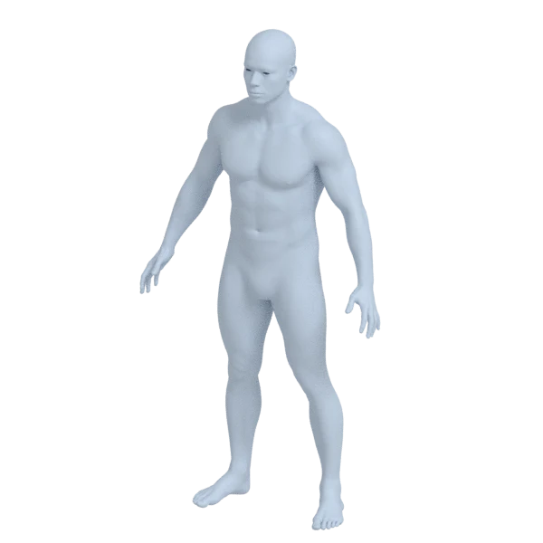
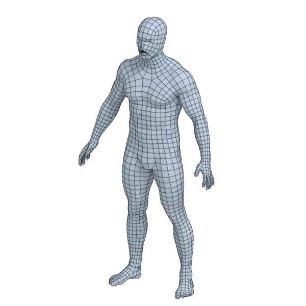
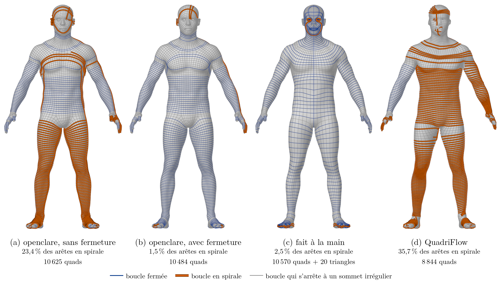
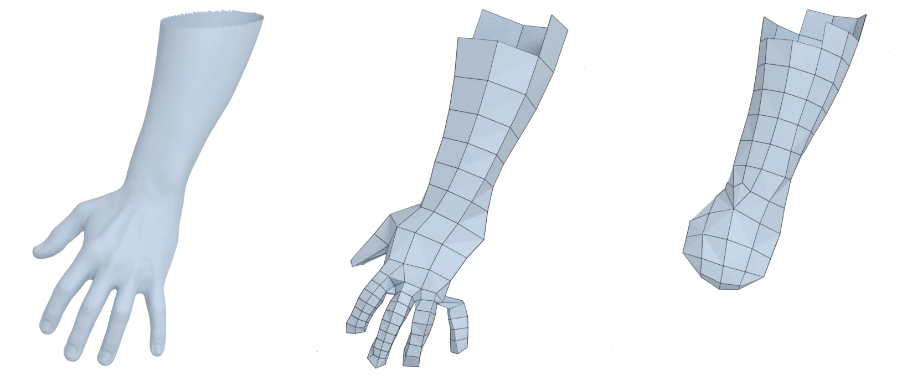

Extension gratuite pour Blender · open source

<h1>Une retopologie propre, en un clic, dans Blender.</h1>

Des quads qui suivent la forme, et des boucles d'arêtes qui se ferment autour d'elle. Gratuit et open source.

<a class="button primary" href="get.fr.md">Télécharger pour Blender</a> <a class="button" href="#voir-en-3d">Voir en 3D</a>

<figure class="pair">

<figcaption>{{shot:human_male:Source}}→ {{shot:human_male:openclare}}</figcaption></figure>

## Ce qu'elle fait pour vous

Sélectionnez un maillage, demandez un nombre de quads, appuyez sur *Remesh to Quads*. L'original reste tel quel.

<strong>Une sculpture prête à animer</strong>Des quads avec peu de pôles, et des boucles autour des yeux, de la bouche et des articulations, tracées sur le modèle là où vous les voulez.

<strong>Une pièce mécanique aux arêtes nettes</strong>Les arêtes vives et les arêtes marquées sharp gardées comme lignes d'arêtes, avec un crease pour le Subdivision Surface.

<strong>Un scan ou un maillage d'IA rendu utilisable</strong>Une surface de quads propre et fermée, à partir d'une surface bruitée.

<strong>Du détail là où il compte</strong>Des quads plus petits sur le visage et les mains, peints ou tirés de la forme.

<strong>Des coutures où vous les voulez</strong>Les courbes tracées sur le modèle deviennent des coutures, prêtes pour les UV.

<strong>Des triangles aussi</strong>Des triangles réguliers pour la simulation de tissu, ou le Decimate de Blender pour l'impression et les collisions.

## Des boucles qui se ferment

Sélectionnez une boucle d'arêtes avec Alt-clic : elle devrait faire une fois le tour du bras et se fermer. Les remailleurs automatiques en font souvent une spirale, qui descend de l'épaule au poignet. openclare ferme ces boucles, et préfère peu de pôles à des quads parfaitement carrés.

*Un corps humain à 10 590 quads : par openclare sans fermeture des boucles, avec fermeture, fait à la main et par QuadriFlow. Les boucles en spirale en vermillon, les boucles fermées en bleu foncé.*

## Des doigts qui restent des doigts

Un corps entier à 3 000 quads laisse peu de quads à chaque main, et beaucoup de remailleurs abandonnent les doigts : ils fondent en moufle. openclare garde au moins six quads autour de chaque partie fine, un doigt ou le bout d'une oreille, avec des quads plus petits là et plus grands ailleurs : la partie garde son volume au lieu de sortir aplatie (*Quads Around Thin Parts*).

*La main droite d'un corps humain demandé à 3 000 quads : la source, openclare (3 032 quads), Instant Meshes (2 800 quads). Sur les parties fines, le banc mesure openclare à 0,09 arête de quad de la source, Instant Meshes à 0,84.*

## Voir en 3D

Tournez autour des résultats d'openclare et de deux autres remailleurs, quad par quad.

## Mesuré en public

<!-- section: night -->

Chaque version passe sur un banc public de {{count:all}} modèles, face à QuadriFlow, intégré à Blender, et à AutoRemesher.

{{mark:3000:organic:openclare}}<small> / 100</small>note moyenne sur {{count:organic}} modèles organiques à 3 000 quads ; AutoRemesher {{mark:3000:organic:autoremesher}}, QuadriFlow {{mark:3000:organic:quadriflow}}

{{mark:3000:mechanical:openclare}}<small> / 100</small>note moyenne sur les pièces mécaniques à 3 000 quads

Chaque modèle, chaque note, et comment elles sont faites : les [résultats](results.fr.md).

## L'obtenir

Une archive pour Linux, Windows ou macOS, installée depuis les préférences de Blender. Rien d'autre à installer, rien de téléchargé pendant qu'elle tourne.

<a class="button primary" href="get.fr.md">Télécharger pour Blender</a>

## Pour aller plus loin

<a class="card" href="articles.fr.md"><strong>Articles</strong>Les outils de retopologie de Blender en 2026, les résultats du banc, la théorie et la recherche.</a>
<a class="card" href="../../docs/GLOSSARY.fr.md"><strong>Glossaire</strong>Les pôles, les boucles d'arêtes, les spirales et les autres mots de la retopologie, en images.</a>
<a class="card" href="get.fr.md"><strong>L'obtenir</strong>L'extension, réglage par réglage, et la ligne de commande.</a>

