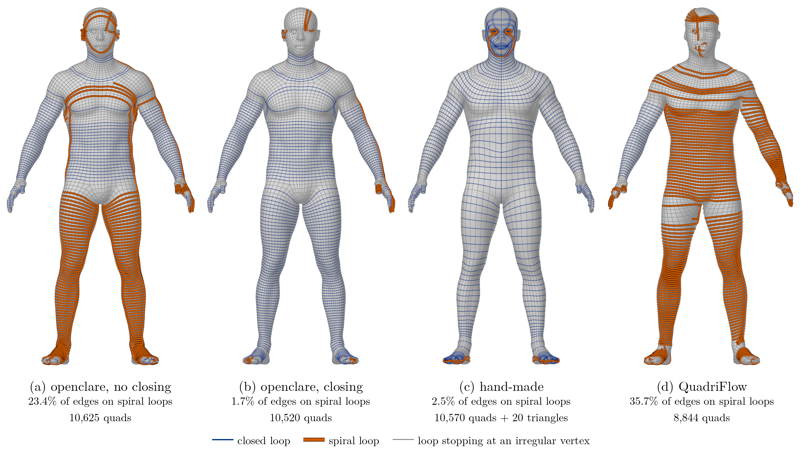

Free add-on for Blender · open source

<h1>Clean retopology, in one click, in Blender.</h1>

Quads that follow the shape, and edge loops that close round it. Free and open source.

<a class="button primary" href="get.md">Download for Blender</a> <a class="button" href="#see-it-in-3d">See it in 3D</a>

<figure class="pair">

<figcaption>{{shot:human_male:Source}}→ {{shot:human_male:openclare}}</figcaption></figure>

## What it does for you

Select a mesh, ask for a number of quads, press *Remesh to Quads*. The original is left as it is.

<strong>A sculpt ready to animate</strong>Quads with few poles, and loops round the eyes, the mouth and the joints, drawn on the model where you want them.

<strong>A mechanical part with crisp edges</strong>Hard edges and marked sharp edges kept as lines of edges, creased for a Subdivision Surface.

<strong>A scan or an AI mesh made usable</strong>A clean, closed surface of quads from a noisy one.

<strong>Detail where it matters</strong>Smaller quads on the face and the hands, painted or taken from the shape.

<strong>Seams where you want them</strong>Curves drawn on the model become seams, ready for the UVs.

<strong>Triangles too</strong>Even triangles for cloth simulation, or Blender's own Decimate for printing and collisions.

## Loops that close

Select an edge loop with Alt-click: it should go round the arm once and close. Automatic remeshers often make it a spiral instead, winding from the shoulder to the wrist. openclare closes those loops, and keeps few poles rather than perfectly square quads.

*A human body at 10,590 quads: by openclare without closing loops, with closing, by hand and by QuadriFlow. Spiral loops in vermillion, closed loops in dark blue.*

## See it in 3D

Turn round the results of openclare and of two other remeshers, quad by quad.

## Measured in public

<!-- section: night -->

Every version runs on a public bench of {{count:all}} models, against QuadriFlow, built into Blender, and AutoRemesher.

{{mark:3000:organic:openclare}}<small> / 100</small>average mark on {{count:organic}} organic models at 3,000 quads; AutoRemesher {{mark:3000:organic:autoremesher}}, QuadriFlow {{mark:3000:organic:quadriflow}}

{{mark:3000:mechanical:openclare}}<small> / 100</small>average mark on the mechanical parts at 3,000 quads

Every model, every mark, and how they are made: the [results](results.md).

## Get it

One archive for Linux, Windows or macOS, installed from Blender's preferences. Nothing else to install, nothing downloaded while it runs.

<a class="button primary" href="get.md">Download for Blender</a>

## Read on

<a class="card" href="articles.md"><strong>Articles</strong>The retopology tools of Blender in 2026, the results of the bench, the theory and the research.</a>
<a class="card" href="../../docs/GLOSSARY.md"><strong>Glossary</strong>Poles, edge loops, spirals and the other words of retopology, with pictures.</a>
<a class="card" href="get.md"><strong>Get it</strong>The add-on, setting by setting, and the command line.</a>

