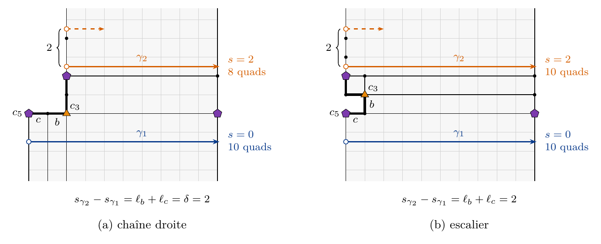

# Recherche

Ce travail est né d'un projet de programmation, openclare, un remailleur en quads libre, et il est devenu une recherche quand l'ingénierie seule ne suffisait plus à dire quels résultats pouvaient être garantis et quels calculs pouvaient être épargnés.

## La méthode

L'auteur de ces articles vient du génie logiciel, et il n'a pas changé d'habitudes en passant à la recherche : un énoncé s'y traite comme du code, qu'on écrit, qu'on teste et qu'on essaie de casser avant d'y croire. Chacune des cinq étapes ci-dessous reprend une pratique de ce métier, et une intégration continue les rejoue toutes à chaque changement. Où en est chaque article : sous chacun d'eux, dans [les deux articles](#les-deux-articles).

<section class="rule">
Étape 1
<h3>Lean d'abord</h3>
<b>Pourquoi</b> Le code formel est la seule source de vérité ; la prose ne fait que l'expliquer.

<b>Comment</b> Chaque énoncé est écrit et démontré en Lean 4 avec Mathlib, avec les trois seuls axiomes standard de Lean et sans preuve laissée ouverte.

<b>Du génie logiciel</b> La source fait foi, la documentation la suit.
</section>
<section class="rule">
Étape 2
<h3>Cas d'école et cas limites</h3>
<b>Pourquoi</b> Un énoncé doit tenir là où l'on connaît la réponse, et à ses bornes.

<b>Comment</b> Des exemples à réponse connue, comme le cube et la sphère, et des cas dégénérés, vérifiés par calcul dans Lean même.

<b>Du génie logiciel</b> Les tests unitaires.
</section>
<section class="rule">
Étape 3
<h3>Tests aléatoires</h3>
<b>Pourquoi</b> Le hasard trouve les cas qu'on n'a pas imaginés.

<b>Comment</b> Des T-meshes tirés au hasard, construits sans le moteur, confrontés aux définitions de Lean énoncé par énoncé.

<b>Du génie logiciel</b> Les tests de propriétés (<em>property-based testing</em>).
</section>
<section class="rule">
Étape 4
<h3>Criblage</h3>
<b>Pourquoi</b> Un test qui ne peut pas échouer est aveugle, et un théorème qui ne contraint rien ne prouve rien.

<b>Comment</b> On altère une définition : le théorème qui la certifie doit casser. On retire une hypothèse : la preuve doit casser, sinon l'hypothèse était superflue.

<b>Du génie logiciel</b> Les tests de mutation.
</section>
<section class="rule">
Étape 5
<h3>La prose</h3>
<b>Pourquoi</b> L'article est une interface : il rend la preuve lisible, il n'ajoute rien.

<b>Comment</b> Chaque énoncé de l'article est écrit depuis sa source Lean et renvoie au théorème qui le porte.

<b>Du génie logiciel</b> La documentation tirée du code.
</section>
<section class="rule">
À chaque changement
<h3>Intégration continue</h3>
<b>Pourquoi</b> L'infrastructure remplace la confiance : une régression se voit tout de suite, sans qu'on la cherche.

<b>Comment</b> Chaque changement reconstruit les preuves sur une version figée de Mathlib et relance les tests ; une étape qui casse bloque la fusion.

<b>Du génie logiciel</b> L'intégration continue.
</section>

## Les deux articles

<article class="paper" aria-labelledby="paper-a">
<header class="paper-head">

Article A · appliqué Brouillon · non relu par des pairs

<h3 id="paper-a">Fermer les boucles d'arêtes à la quantification : contraintes d'hélice pour la quantification d'un T-mesh</h3>
</header>

Le remaillage automatique en quads produit souvent des boucles d'arêtes qui s'enroulent en hélice autour d'une partie de la forme au lieu de se refermer en anneaux. Bommes et al. retirent ces <em>q-hélices</em> d'un maillage fini ; nous les empêchons là où se décide la structure entière du maillage, dans la quantification d'un T-mesh.

<a class="button primary" href="../../docs/research/closing-loops/paper.fr.pdf">PDF · français · 20 p.</a> <a class="button" href="../../docs/research/closing-loops/paper.pdf" hreflang="en" lang="en">PDF · English · 18 p.</a> <a class="button plain" href="../../docs/research/closing-loops/paper.fr.tex">Source LaTeX</a>

La version française est une traduction faite au mieux ; la version anglaise fait foi. Son titre anglais : <em lang="en">Closing Edge Loops at Quantization Time: Helix Constraints for T-Mesh Quantization</em>.

<figure><figcaption>Figure 3 · boucles en spirale en vermillon, boucles fermées en bleu foncé</figcaption></figure>

</article>

<article class="paper" aria-labelledby="paper-b">
<header class="paper-head">

Article B · théorie Brouillon · non relu par des pairs

<h3 id="paper-b">Les tours d'un T-mesh : obstructions à la fermeture des boucles d'arêtes</h3>
</header>

Dans la quantification d'un T-mesh, une boucle d'arêtes se ferme en anneau quand un <em>tour</em>, une marche droite à travers les patchs qui revient sur son premier côté, a un <em>décalage</em> nul, une forme linéaire entière en les longueurs des arcs ; sinon elle s'enroule en hélice. Nous étudions pourquoi les tours ne peuvent pas tous être fermés.

<a class="button primary" href="../../docs/research/turns-of-a-t-mesh/paper.fr.pdf">PDF · français · 29 p.</a> <a class="button" href="../../docs/research/turns-of-a-t-mesh/paper.pdf" hreflang="en" lang="en">PDF · English · 26 p.</a> <a class="button plain" href="../../docs/research/turns-of-a-t-mesh/paper.fr.tex">Source LaTeX</a>

La version française est une traduction faite au mieux ; la version anglaise fait foi. Son titre anglais : <em lang="en">Turns of a T-Mesh: Obstructions to Closing Edge Loops</em>.

<figure><figcaption>Figure 2 · une paire de sommets de valence 3 et 5 : en dessous, le tour se ferme en anneau (décalage 0) ; au-dessus, il part en hélice (décalage 2)</figcaption></figure>

</article>

## Assistance par IA

Les deux articles et le logiciel qu'ils décrivent ont été faits par un auteur humain travaillant avec des systèmes d'IA, qui n'en sont pas auteurs. Suivant la pratique recommandée par l'ACM et par Nature, chaque article dit comment le travail s'est partagé.

**L'auteur humain a fait de sa méthode un processus de doute.** Une IA écrit vite et avec assurance, y compris ce qui est faux. Plutôt que de croire le texte, l'auteur a exigé que chaque énoncé passe les cinq étapes de [la méthode](#la-méthode) : écrit en Lean, essayé sur des cas connus puis au hasard, attaqué par criblage, et seulement ensuite raconté en prose. Il a aussi choisi le problème et ses buts : des boucles d'arêtes qui se ferment en anneaux, la sphère en quads aux huit pôles d'un cube comme cible et, en artiste, peu de sommets singuliers plutôt que des quads parfaitement carrés. Il a fixé l'ordre du travail, décidé quels résultats poursuivre et quels changements fusionner dans le moteur, et jugé les résultats sur les mesures, les images et les brouillons.

**Les systèmes d'IA**, Claude Opus 5.5 et Claude Fable 5.1 (Anthropic), utilisés via Claude Code avec plusieurs sous-agents en parallèle, ont fait le reste : les changements du moteur et les scripts d'expérience, les expériences et le banc, les calculs exacts, la recherche bibliographique, les énoncés et les preuves, la formalisation en Lean et les brouillons du texte. L'existence des références a été vérifiée, et chaque entrée des bibliographies dit quelle part de l'ouvrage a été lue.

**Ce qui a été vérifié, et comment.** Les cœurs algébriques sont vérifiés par machine en Lean, avec les seuls axiomes standard de Lean. Les hypothèses topologiques que Lean prend pour acquises, et les preuves données seulement sur papier, ont été vérifiées par des agents d'IA qui les ont relues et testées sur les données, pas par un expert humain. Chaque chiffre mesuré peut être reproduit à partir des scripts et des branches que les articles nomment. Aucun des deux articles n'a été relu par des pairs ; des erreurs restent possibles, et l'auteur, qui les publie, est responsable de leur contenu.
