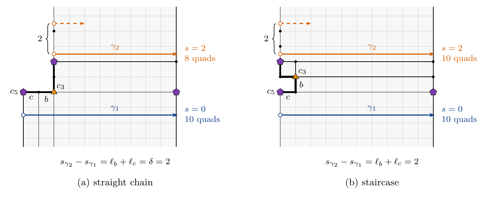

# Research

This work began as a programming project, openclare, an open-source quad remesher, and became research when engineering alone could no longer tell which results could be guaranteed and which computations could be saved.

## The method

The author of these papers comes from software engineering, and did not change habits on moving to research: a statement is treated there like code, written, tested and attacked before it is believed. Each of the five steps below takes up a practice of that trade, and continuous integration replays them all at every change. Where each paper stands is shown under it, in [the two papers](#the-two-papers).

<section class="rule">
Step 1
<h3>Lean first</h3>
<b>Why</b> Formal code is the only source of truth; the prose only explains it.

<b>How</b> Each statement is written and proved in Lean 4 with Mathlib, with Lean's three standard axioms only and no proof left open.

<b>From software engineering</b> The source is authoritative, the documentation follows it.
</section>
<section class="rule">
Step 2
<h3>Known cases and edge cases</h3>
<b>Why</b> A statement must hold where the answer is known, and at its limits.

<b>How</b> Examples whose answer is known, such as the cube and the sphere, and degenerate cases, checked by computation in Lean itself.

<b>From software engineering</b> Unit tests.
</section>
<section class="rule">
Step 3
<h3>Random tests</h3>
<b>Why</b> Chance finds the cases nobody thought of.

<b>How</b> T-meshes drawn at random, built without the engine, checked against the Lean definitions statement by statement.

<b>From software engineering</b> Property-based testing.
</section>
<section class="rule">
Step 4
<h3>Screening</h3>
<b>Why</b> A test that cannot fail is blind, and a theorem that constrains nothing proves nothing.

<b>How</b> Alter a definition: the theorem that certifies it must break. Remove a hypothesis: the proof must break, or the hypothesis was not needed.

<b>From software engineering</b> Mutation testing.
</section>
<section class="rule">
Step 5
<h3>The prose</h3>
<b>Why</b> The paper is an interface: it makes the proof readable, it adds nothing.

<b>How</b> Each statement of the paper is written from its Lean source and points to the theorem that carries it.

<b>From software engineering</b> Documentation generated from the code.
</section>
<section class="rule">
At every change
<h3>Continuous integration</h3>
<b>Why</b> Infrastructure replaces trust: a regression shows at once, without anyone looking for it.

<b>How</b> Every change rebuilds the proofs on a pinned Mathlib and runs the tests again; a step that breaks blocks the merge.

<b>From software engineering</b> Continuous integration.
</section>

## The two papers

<article class="paper" aria-labelledby="paper-a">
<header class="paper-head">

Paper A · applied Draft · not peer reviewed

<h3 id="paper-a">Closing Edge Loops at Quantization Time: Helix Constraints for T-Mesh Quantization</h3>
</header>

Automatic quad remeshing often produces edge loops that wind round a part of the shape as helices instead of closing into rings. Bommes et al. remove such <em>q-helices</em> from a finished mesh; we prevent them where the integer structure of the mesh is decided, in the quantization of a T-mesh.

<a class="button primary" href="../../docs/research/closing-loops/paper.pdf">PDF · English · 18 p.</a> <a class="button" href="../../docs/research/closing-loops/paper.fr.pdf" hreflang="fr" lang="fr">PDF · français · 20 p.</a> <a class="button plain" href="../../docs/research/closing-loops/paper.tex">LaTeX source</a>

The French version is a best-effort translation; the English one is authoritative.

<figure><figcaption>Figure 3 · spiral loops in vermillion, closed loops in dark blue</figcaption></figure>

</article>

<article class="paper" aria-labelledby="paper-b">
<header class="paper-head">

Paper B · theory Draft · not peer reviewed

<h3 id="paper-b">Turns of a T-Mesh: Obstructions to Closing Edge Loops</h3>
</header>

In the quantization of a T-mesh, an edge loop closes into a ring when a <em>turn</em>, a straight walk across the patches that returns to its first side, has zero <em>shift</em>, an integer linear form in the arc lengths; otherwise it winds as a helix. We study why turns cannot all be closed.

<a class="button primary" href="../../docs/research/turns-of-a-t-mesh/paper.pdf">PDF · English · 26 p.</a> <a class="button" href="../../docs/research/turns-of-a-t-mesh/paper.fr.pdf" hreflang="fr" lang="fr">PDF · français · 29 p.</a> <a class="button plain" href="../../docs/research/turns-of-a-t-mesh/paper.tex">LaTeX source</a>

The French version is a best-effort translation; the English one is authoritative.

<figure><figcaption>Figure 2 · a pair of vertices of valence 3 and 5: below it the turn closes into a ring (shift 0), above it the turn winds as a helix (shift 2)</figcaption></figure>

</article>

## AI assistance

Both papers and the software they describe were made by a human author working with AI systems, which are not authors. Following the practice recommended by ACM and by Nature, each paper states how the work was divided.

**The human author made his method a process of doubt.** An AI writes fast and with confidence, including what is false. Rather than believe the text, the author required every statement to pass the five steps of [the method](#the-method): written in Lean, tried on known cases and then at random, attacked by screening, and only then told in prose. He also chose the problem and its aims: edge loops that close into rings, the quad sphere with the eight poles of a cube as a target and, as an artist, few singular vertices rather than perfectly square quads. He set the order of the work, decided which results to pursue and which changes to merge into the engine, and judged the results through the measurements, pictures and drafts.

**The AI systems**, Claude Opus 5.5 and Claude Fable 5.1 (Anthropic), used through Claude Code with several sub-agents in parallel, did the rest: the changes to the engine and the experiment scripts, the experiments and the bench, the exact computations, the search of the literature, the statements and proofs, the Lean formalization and the drafts of the text. References were checked for existence, and each entry of the bibliographies says how much of the work was read.

**What was checked, and how.** The algebraic cores are machine-checked in Lean, with Lean's standard axioms only. The topological hypotheses Lean takes as given, and the proofs given only on paper, were checked by AI agents rereading them and testing them on the data, not by a human expert. Every measured figure can be reproduced from the scripts and branches the papers name. Neither paper has been peer reviewed; errors remain possible, and the author, who publishes them, is responsible for their content.
