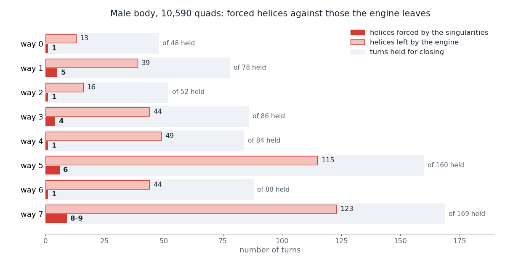
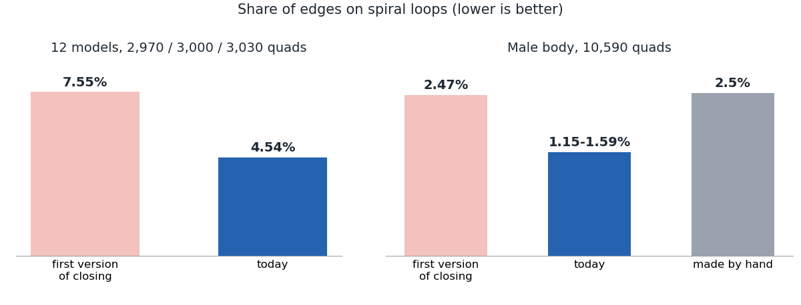

# Closing edge loops: the theory in plain words

*[Version française](theory.fr.md)*

This page tells, for 3D artists and curious developers, what the two research papers,
[Closing Edge Loops at Quantization Time](../../docs/research/closing-loops/paper.pdf) (applied) and
[Turns of a T-Mesh](../../docs/research/turns-of-a-t-mesh/paper.pdf) (theory), found while
teaching openclare to close its edge loops: the idea, the rules that came out of it, what it
changed in the engine, and what did not work. It takes about fifteen minutes to read. Words in
*italics* are defined, with more pictures, in the [glossary](../../docs/GLOSSARY.md).

Every statement below is one of three kinds, and we say which:

- **proved**: a proof exists, and for most of them a computer has checked it (section 8);
- **measured**: computed on real meshes, exactly where we say so;
- **conjectured** or **refuted**: a guess, still open or shown false.

The note is a draft and has not been peer reviewed.

## 1. The problem an artist sees

Ask an automatic remesher for a quad mesh of an arm, and look at the lines of edges that go
round it. An artist expects each of them to be a *ring*: it goes round once and closes on
itself, so you can select it with one Alt-click, slide it, or cut the mesh along it. Very often
it is a *helix* instead: it goes round, comes back one row higher, and winds up the whole arm
like the thread of a screw.

*Left, a ring: it comes back to its start. Right, a helix of pitch 1: it comes back one row
higher. Below, the same tubes cut open and laid flat.*

A helix is not wrong geometrically: the quads can be square and follow the shape perfectly. It
is wrong for the person who has to edit the mesh. One spiral can turn a whole leg into a single
loop from hip to ankle, and that is exactly what openclare did on the male body we use as a
witness, before this work.

Here is a cylinder, remeshed by openclare before and after the work described here.

*Before: the loops spiral (red), across about 700 patches. After: every loop is a ring (blue),
and the layout is that of a cube, 6 patches.*

And the male body, remeshed at 10,590 quads, the number of quads of the base mesh an artist
made by hand for it.

*Spiral loops in yellow to red, closed loops in blue, from an earlier run of the engine. Today's
engine: 26.8% of the edges on spiral loops with no closing, 1.95% with it, against 2.55% for the
mesh made by hand.*

The problem is well known. Bommes and his colleagues named these helices *q-helices* in 2011
and removed them from a finished mesh by local edits. openclare takes the opposite route: it
prevents them earlier, at the moment the mesh decides how many quads go where.

## 2. How openclare builds a quad mesh

To see where helices are born, follow the five steps of the engine.

**1. A cross field.** On every point of the surface, openclare computes a cross with four arms
at right angles: the directions the edges should follow. The crosses follow the bend of the
shape. At a few points the cross turns by a quarter turn as you go round: these are the
*singularities*, and each becomes a *pole* of the mesh, a vertex with 3 or 5 edges instead of
4.

*Left: the crosses follow the bend. Right: going once round a singularity, the cross comes back
turned by a quarter turn; three lines leave it, and it becomes a pole of valence 3.*

**2. Lines from the poles.** From every pole, openclare follows the lines of the field that
leave it (the *separatrices*) until each one hits another line or a border.

**3. A patchwork of rectangles.** These lines cut the surface into rectangles, the *patches*.
Their sides are made of pieces of line, the *arcs*. This patchwork is called a *T-mesh*,
because a line that stops on another makes a T. On the male body it has 776 patches and 2,069
arcs.

*The lines leaving the poles cut the surface into rectangles of quads.*

**4. Whole lengths.** Each arc must now receive a whole number of quad edges. The field asks
for real lengths, like 3.4 or 5.7; rounding each one on its own breaks the rectangles, whose
opposite sides must stay equal. Choosing whole numbers that keep every rectangle a rectangle,
as close as possible to what the field asks, is called *quantization*.

*Left, what the field asks. Middle, plain rounding: the left side has 5 edges, the right side
2 + 2, the quads do not fit. Right, quantization: 5 = 2 + 3.*

**5. Quads.** Each rectangle, now with whole sides, is filled with a grid of quads.

Step 4 is where the integer structure of the mesh is decided, and with it, as we found, whether
each loop closes or spirals. Before this work, openclare chose the whole lengths for
consistency and closeness to the field only; the loops closed or spiralled by chance.

## 3. The key idea: a turn, and its shift

Start in a patch, walk straight across it, go into the next patch, and keep going straight.
Sometimes you come back into the patch you started from, through the same side, in the same
direction. That walk is a *turn*. The strip of quads that follows it is either a ring or a
helix.

Where exactly you come back along that side is the *shift* of the turn: 0 for a ring, the
pitch of the helix otherwise.

*A turn walks across the patches round a tube. Above, it comes back at its start: shift 0, a
ring. Below, one row higher: shift 1, a helix of pitch 1.*

The first result of the note (**proved**) is that the shift is a plain sum of arc lengths, with
whole coefficients that depend only on which patches the walk crosses, not on the lengths
themselves. Something like:

> shift = length of arc 3 + length of arc 7 − length of arc 12

So **closing a loop means making one number zero**, and that number is a simple sum of the
very lengths quantization chooses. Closing loops becomes a constraint the quantizer can be
asked to meet, like the equal sides of the rectangles.

The second result (**proved**, and checked by computer) answers the question "how do we find all
the turns?". Walk from the middle of every quad edge on every side of every patch: you meet
every strip of quads of the final mesh, with nothing missed. On the male body this complete walk
finds about 220 ways round for each way the engine tries (section 6), and 12 to 24 of them come back shifted although the field
itself shifts them by less than half a row: rings that rounding spoiled. The sampled walks the
engine used before had found only 4 to 10 of those (**measured**).

## 4. Where shifts come from

Why does a turn come back shifted? The answer is borrowed from the physics of crystals.

**The Burgers vector.** In a perfect crystal, walk 6 steps right, 6 up, 6 left and 6 down: you
are back where you started. If the crystal has a defect, an extra half row of atoms, the same
walk misses its start by one step. That missing step is the *Burgers vector* of the defect.

A quad mesh is a crystal of quads, and its defects are its poles. A pole of valence 3 next to a
pole of valence 5, a *3/5 pair*, is exactly a crystal defect: a walk round it misses its start
by one edge across and one edge along.

*Left, a crystal with an extra half row: the square walk misses by one step. Right, the same
walk round a 3/5 pair of a quad mesh. Both walks are computed, not drawn by hand.*

The note proves that **the shift of a turn is the Burgers vector of the poles on one side of
it**, added up in a precise order (the order a walk round them first meets them). It is not
the field that spirals; it is the poles that push the rows. **Measured:** on the male body, it
holds on all 1,436 regions tested, with no exception.

**The staircase.** Put a 3/5 pair between two turns of a limb. The difference of their shifts
is then the length of a *staircase*: a path of edges from the 5 to the 3, going in two
directions a quarter turn apart.

*Turn 1 is a ring, turn 2 comes back 2 rows higher, and 2 is the length of the staircase from
the 5 to the 3. Shifts measured on the mesh.*

Both turns can be rings only if the staircase has length zero, that is, if the two poles merge.
But openclare keeps poles at least one edge apart, so that they do not collapse into each other.
Then one of the two turns at least must be a helix (**proved**).

**The winding separatrix.** One loop of the male body, round the left wrist, can never close,
whatever the lengths. The reason is a line that leaves a pole of valence 5, goes once round the
wrist (6.99 edges) and lands on another line of the same pole, 0.3 edges beside it. The turn
round the wrist comes back shifted by exactly that gap. Since the gap contains an arc that must
stay at least one edge long, the wrist turn is a helix of pitch at least 1 under every
admissible choice of lengths (**proved**; the identity **measured** on the mesh).

*The line leaves the pole, goes round the wrist and lands just beside its own pole; the turn
round the wrist inherits the gap.*

When two turns of the male body cannot close together, we had guessed it would always be a 3/5
pair sitting on one line between them. That guess was **refuted**: it held in 0 of the 13
conflicts we examined. They fall into six configurations: one staircase between a 3/5 pair,
three swaps of two poles of valence 3 between turns that cross, and two longer loops, one round
a cap like a fingertip.

**Combs.** There is a simpler way to read every conflict. Take any arc of the patchwork: the
two lines that end it each start from a pole. Together they make a *comb*, from one pole,
across the arc, to the other. The length of the arc is exactly how far apart those two poles
sit across the arc's direction (**proved**, **measured** on all 2,069 arcs of the male body). So
nearly every arc is a tiny 3/5 pair or a swap of two poles, and every proof that some turns
cannot close together is a sum of combs (**proved**). The two longer loops above are closed
chains of six and of four combs.

## 5. Rules nobody can break

Some constraints hold for every quad mesh, whatever the software and whoever the modeller.

**Counting the poles.** Give each pole an *index*: +1 for valence 3, −1 for valence 5. On any
closed surface shaped like a ball, the indices add up to 8: a quad sphere needs at least eight
poles of valence 3, the corners of a cube (**proved**, classical). The male body has 133 poles
of valence 3, 127 of valence 5 and one of valence 2 (index +2): 133 − 127 + 2 = 8. And a ring
always cuts such a surface into two halves whose indices are 4 each: a fingertip beyond a ring
holds the equivalent of four poles of valence 3. Holes change the count: the side of a ring
that contains a hole holds 4 less per hole, so a ring hugging a hole can have no pole at all on
its side. Such a *collar* round a hole with straight edges always closes (**proved**;
**measured** on all 40 collars round Suzanne's eyes).

*The QuadSphere: 8 poles of valence 3, 6 patches, every loop a ring. openclare now produces it
on a sphere.*

**Parity: rings have an even number of quads.** On a closed surface shaped like a ball, colour
the vertices of the quads in two colours so that neighbours always differ; it can always be
done. Going round a ring,
the colours alternate, so **every ring has an even number of quads** (**proved**). A consequence
that matters for the engine: a helix of odd pitch can only become a ring if the number of quads
round it changes by an odd number. A small repair that keeps that number can never close it.
**Measured** on all 1,299 turns of the male body.

*Left, on a closed surface the colours alternate: here a ring of 16 quads. Right, round a hole
the colours can clash, and a ring of 5 quads is possible.*

**The surprise: borders break it.** We first stated the parity rule for every surface shaped
like a sphere. The computer check of the proofs (section 8) showed that it needs the surface to
be *closed*. And it is false in practice: on Suzanne, the monkey head of Blender, whose eyes are
holes, openclare made a ring of **23 quads** round an eye socket (**measured**). With other
lengths, the same ring has 24. The corrected rule (**proved**, **measured** on 660 of 660 turns
of Suzanne, jerry and a dome) says that with borders, the length plus the shift of a turn has
the parity of the border length on one side of it.

**The checkerboard rule.** Between two parallel turns, colour the whole points of the plane like
a checkerboard and count the poles of valence 3 or 5 that sit on white points. If that count is
odd, the two turns cannot both be rings (**proved**; **measured** on 30,148 pairs of turns of
the male body).

*A quarter turn about a whole point keeps the colours. Middle: one pole on a white point, the
two turns cannot both be rings. Right: zero, this rule does not forbid it.*

**Forced helices.** Turn the obstructions round and they give a floor: if a group of turns can
never close all together, at least one of them is a helix in *every* quad mesh with these poles
kept apart. With several separate groups, the helices add up. For instance, a limb with three
3/5 pairs stacked the same way has at least three helices among its four turns (**proved**).

*Each 3/5 pair adds the length of its staircase to the shift, always the same way: at most one
of the four turns can be a ring.*

We know of no earlier lower bound of this kind. On the male body (**measured**, computed exactly
with an optimization solver), the poles force only **1 to 9 helices** among the turns held for
closing, depending on the run, where the engine left **13 to 123**. One forced helix is the wrist; the others sit at
the eyes, the hands and the feet.

*For each of the eight ways the engine tries, the helices no quantization can avoid (dark red)
against the helices the engine left (light red).*

This was the most useful lesson of the theory: **the poles are not the main culprit**. Most
helices the engine leaves could be closed by other lengths. What keeps them open is the cost
(quads less square) and the size asked for, and the heuristic that chooses which turns to close.

## 6. What it changed in openclare

The engine now finds the turns of every patch, asks the quantizer to bring their shifts to
zero, repairs the few that rounding leaves shifted, and tries eight *ways* of choosing which
turns to hold, keeping the one with the fewest spirals. After each search it walks every strip
of the mesh (the complete walk of section 3), adds the rings the field would have closed, and
searches again. Finally it checks that no quad folds over, and falls back on other lengths if
one does.

The numbers, all **measured** on the bench, are in shares of edges lying on spiral loops (lower
is better). A single model's share is chaotic: a 1% change of the quad count moves it as much as
a real fix. So changes are judged on 12 models at three budgets, 2,970, 3,000 and 3,030 quads.

*The first version of closing and today, on the 12-model batch over three budgets and on the
male body.*

- **12-model batch.** With no closing at all, 16.7% of the edges were on spirals (at 3,000
  quads); the first version of closing brought it to 6.0%. Over three budgets, the first
  version leaves 7.55% and today's engine **4.54%**, with 36.3% of edges on closed loops
  instead of 34.1%, no invalid mesh, and a mean distance to the source 1.2% higher.
- **Male body, 10,590 quads.** With today's engine, 26.8% with no closing and **1.95%** with it
  ([figures of the paper](../../docs/research/closing-loops/figures/README.md), one run); the mesh made by hand has 2.55%. Earlier engines gave
  12.1% with no closing, 2.47% with the first version of closing, then 1.15% to 1.59%. One model is
  chaotic, so this is an illustration; the batch above is the evidence.
- **Cylinder.** **No spiral and 6 patches** at 2,990, 3,000 and 5,000 quads, against 26% to
  32% of spiral edges and about 700 patches before.
- **Against other remeshers** (full bench of 31 models at 3,000 quads, first version of
  closing): 12.3% of spiral edges for openclare (17.3% without closing), 21.9% for QuadriFlow,
  25.3% for AutoRemesher.
- **Night bench of 18 October**, organic models, marks out of 100 (before closing, first
  version, today): overall 72.9 → 86.0 → **86.2** at 3,000 quads; the loops mark 43 → 76 →
  **77** at 3,000 and 33 → 68 → **74** at 1,000. The large models lost a little at 1,000 and
  8,000 quads, and one model with 373 pieces regressed; it has its own ticket.

**Simplicity.** One more lever came from the artist's side rather than from the theory: an
artist prefers few poles and few spirals to perfectly square quads. The *simplicity* slider,
from 0 to 1, removes nearby 3/5 pairs and accepts quads a little less square in exchange.

*The male body at simplicity 0, 0.25 (the presets), 0.5 and 1: 303, 259, 213 and 172 poles.*

## 7. Doors we closed

Research is mostly ideas that fail. These did, and the note says why.

- **Moving the poles, or untwisting the field cylinder by cylinder,** before quantization.
  Since the poles set the shifts, why not move them until every shift is zero? Prototypes of
  the engine tried both, and neither lowered the spirals: the shifts of two neighbouring turns
  differ by the Burgers vector of the poles between them, so closing one turn by a local change
  moves its shift onto the next one. The theory still holds exactly: the field sets where the
  poles land in the flattened map, not where they sit on the surface.
- **Closing every ring at once.** On the male body we asked for all 218 ring-like ways round
  (109 strips) of one run. It is possible in theory, but it forces 171 arcs to length zero and
  makes 3,960 quads instead of about 10,500, with quads far less square than the engine accepts
  (a mean deviation of at least 0.817 edge per arc, against a cap of 0.474). A subset of 190
  rings fits; whole lengths closing all 190 exist and were found, yet that mesh spirals on 2.5%
  of its edges against 1.1% for the engine: closing some rings moves the strips, and other
  loops spiral instead.
- **"Conflicts are 3/5 pairs on one line"**: refuted, 0 of 13 (section 4). A first conjecture,
  "conflicts are always the borders of one region round a cluster of poles", is also refuted as
  stated.
- **Conjecture 2, "conflicts are sums of local dislocations".** Read strictly (staircases,
  caps and winding lines only), it is **false**: two conflicts of the male body, at the left eye
  and the right foot, are shown not to be such sums, in exact arithmetic. Read loosely, it is
  **true but empty**: almost every arc is itself a tiny dislocation (2,046 of the 2,069 arcs of
  the male body join two poles of odd valence through the lines that end it), so any
  obstruction can be written that way, which tells nothing about the poles.
- **Choosing the rings optimally.** An exact solver that closes as many rings as possible,
  while making sure each closed ring stays the same strip, gives excellent extra candidates:
  added to the engine's own, the 12-model batch drops from 4.54% to **2.32%** and 2.70% in two
  runs, never worse, where simply drawing three more candidates at random gives 4.12% to
  4.34%. But it only works when the solver finishes. With 5 seconds per solve, about what the
  engine can afford, half of the pieces got no solution and the gain vanished (4.10%). On the
  male body every round spiralled more than the engine (3.45% to 5.59% against 1.59%). A fast
  version inside the engine closed no more rings than before. Not adopted, and a lesson:
  closing the most rings is not, on its own, the way to fewer spirals.

## 8. How we know it is true

**Machine-checked proofs.** The algebraic heart of every result above is proved in
[Lean](../../docs/research/turns-of-a-t-mesh/lean/README.md), a proof assistant: a program that accepts a proof only if every step
follows from the previous ones. There are **187 theorems**, built on the Mathlib library, using
only Lean's standard axioms and no unfinished proof. They replay in about 40 seconds with
`make proofs`. They cover the shift as a sum of lengths, the completeness of the walk, the
Burgers sum and its order, dislocations and staircases, the checkerboard rule, the parity of
rings (with two different proofs), the counting of poles on a grid, the structure of the
whole lengths, the certificates that a group of turns cannot close, and the forced helices.
Several of them also hold beyond quads, for triangle and hexagon meshes.

**What is assumed, not proved by the computer.** The topology: that a closed curve on a sphere
cuts it into two discs, how a loop unfolds onto the plane, how the loops round the poles
generate all the others. Each is written as an explicit hypothesis of the theorem that uses it.
Formalizing it would take weeks, much of it missing from Mathlib. The newest results, on
surfaces with borders and handles, on combs and on how hard it is to choose the rings, are
proved on paper (and the first two measured), not yet in Lean.

**Gaps the computer found.** It found no wrong sign, but several gaps, now corrected:

- "genus zero" had to mean *closed*: the parity rule is false with borders, which led to the
  23-quad ring round Suzanne's eye;
- the forced-helices theorem needs neither convexity nor whole lengths, so it also holds when
  the number of quads is fixed;
- for the rectangles' equations, the one parity condition the note had found is the *only*
  obstruction to whole solutions;
- a few hypotheses missing from proofs (an edge that must exist, whole bounds for whole
  certificates), and a second, simpler proof of the parity rule.

**Numerical checks.** More than 30,000 configurations, on real data: the checkerboard rule on
30,148 pairs of turns and 1,436 regions of the male body, 13,000 random configurations, all
1,299 turns of the male body for the general
formula, 660 turns of models with borders. Exact rational or integer arithmetic is used where a
floating-point answer could mislead.

**What nobody has checked.** No human mathematician has reviewed the proofs yet. The paper
proofs and Lean's hypotheses were reread by AI agents and tested on the data, which is not the
same thing.

## 9. Open questions

- **Which turns to close?** This is the central question. Closing rings changes the lengths,
  the lengths change the strips, and the new strips are other walks. Is there a small set of
  turns whose closing guarantees that every loop of the mesh closes?
- **Whole lengths at the speed of the engine.** Exact solvers find whole lengths that close the
  rings asked for, but in minutes. Can the quantizer do it in a fraction of a second, with the
  number of quads held exactly?
- **Floors at a given size.** The forced-helices theorem holds when the number of quads is fixed,
  but we do not yet know how to compute the floor in that case.
- **When can a group of turns close together**, read directly from the poles? Every conflict
  is a sum of combs, but so is almost anything, so that says little; and two conflicts of the
  male body (the left eye and the right foot) are provably not made of staircases and caps
  alone. The useful answer lies somewhere in between.
- **Is there a fast perfect algorithm? No** (**proved**, unless P = NP). Choosing which rings
  to close is at least as hard as a famous puzzle: in a network of people, find the largest
  group in which nobody knows anybody else. For any such network we can build a small patchwork
  of rectangles in which the groups of rings that can close together are exactly those groups.
  So no method can always find the best choice quickly, unless P = NP, a question open since
  1971 that most researchers expect to be answered no. It cannot even be approximated well: no
  fast method can promise to leave fewer than about 1.4 times the least possible number of
  helices, unless P = NP. This is the worst case, on patchworks built on purpose; that the
  patchworks of real meshes are just as hard is a **conjecture**. On the male body, exact
  solvers still find the least number of forced helices in under half a minute when only the
  spacing of the poles counts; with the engine's limits on distortion and size they only give
  ranges. The engine's choice will stay a heuristic, and research should look for good choices,
  not perfect ones.

## 10. Who did what

openclare and this note were made by a human author working with an AI system. The human
author chose the problem and the aims: edge loops that close into rings, the quad sphere
with the eight poles of a cube, and, as an artist, few poles and few spirals rather than
perfectly square quads, always quads only. He set the direction and the order of the work, and
decided what to pursue, what to merge into the engine and what to drop. Claude Opus 5.5
(Anthropic), through Claude Code, with several agents working in parallel, wrote the engine
changes and the scripts, ran the experiments and the bench, carried out the exact computations,
stated and proved the propositions, wrote the Lean proofs and drafted the note and this page.
No AI system is an author of the note; the human author, who publishes it, is responsible for
its content.

## Read more

- Paper A, applied: [paper.pdf](../../docs/research/closing-loops/paper.pdf) (in French: [paper.fr.pdf](../../docs/research/closing-loops/paper.fr.pdf)), source [paper.tex](../../docs/research/closing-loops/paper.tex).
- Paper B, theory: [paper.pdf](../../docs/research/turns-of-a-t-mesh/paper.pdf), source [paper.tex](../../docs/research/turns-of-a-t-mesh/paper.tex).
- The machine-checked proofs: [lean/README.md](../../docs/research/turns-of-a-t-mesh/lean/README.md).
- The glossary, with all the pictures: [GLOSSARY.md](../../docs/GLOSSARY.md).
- The pictures are drawn by [make_figures.py](../../docs/glossary/make_figures.py).
